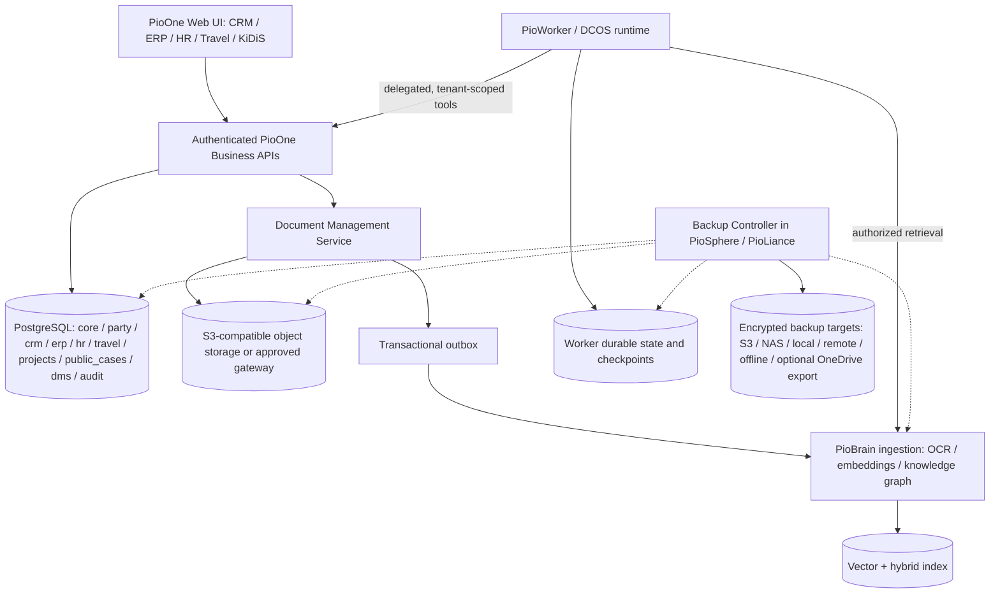

# PioOne V27 — Data Architecture, Residency, Document Management, Backup & Recovery

**Edition:** 27.0.0 · **Date:** 20 November 2026 · **Status:** frontend prototype plus production architecture specification
**Target path:** `app/webui/` · **Scope:** PioOne, PioBrain, PioWorker/PioAgent, PioSphere COS, PioLiance, KiDiS

## 0. Implementation status and non-goals

| Area | Present in V27 Web UI | Required for production |
|---|---|---|
| Existing applications | V26 screens retained; 14 application groups / 99 catalog modules | Business backend services, tenancy and production auth |
| DCOS workflows | 12 enterprise/public templates, local demo execution and approvals | PioWorker/PioAgent API orchestration, durable jobs and audit |
| Data Residency & Storage | Deployment, PostgreSQL, DMS, RAG and worker locality selectors; validation; JSON export | Service registry, secret vault, secure gateway, connectivity tests, migration execution |
| Backup destinations | SSD, NAS, S3, OneDrive export, remote DC, offline media planning | Agent connections, encryption keys, policy enforcement, scheduling |
| Policies and recovery | Local drafts, sample manifests, restore plan, release selectors, compatibility warnings | Coordinated backups, WAL/PITR, integrity verification, recovery and cutover |
| Auditing | Local prototype activity history | Append-only, server-generated tenant-scoped audit and independent retention |

**No live backup, credential enrollment, database connection, migration, recovery or payment is performed by the Web UI.** Browser localStorage is not authoritative and must not be used for secrets, legal records, or production permissions.

## 1. System boundaries and source-of-truth rules

- **PioOne business API**: authenticated system-of-record for commercial and public-sector transactions. CRM and ERP remain authoritative for their domain records.
- **PioOne DMS**: metadata, document IDs, folder hierarchy, types, revisions, ACL and retention. Object content stored separately by immutable object version reference.
- **PioBrain**: ingestion/OCR, embeddings, graph and authorized retrieval; derived indexes are not the official source documents.
- **PioWorker / PioAgent**: worker definition, playbook and tool versions, execution checkpoints and personal/worker memory; DCOS invokes tools through business APIs.
- **PioSphere COS / PioLiance**: infrastructure control plane, secure data gateways, backup operations, storage migrations and disaster recovery.
- **Human approvers**: legally and operationally significant approvals remain with delegated people or formally permitted automated decisions; frontend role selection is not authorization.

## 2. Data ownership and PostgreSQL domains

| Schema | Primary entities | Owner |
|---|---|---|
| `core` | tenants, organizations, departments, teams, memberships, roles, identity mappings | PioOne IAM |
| `party` | person, organization/party, address, party-role, contact methods | Party Registry |
| `crm` | leads, accounts, contacts, opportunities, pipeline stages, activities, quotes, quote revisions | CRM |
| `erp` | product/pricing, sales orders, AP/AR, invoices, payments, supplier references, ledger | ERP |
| `projects` | projects, tasks, milestones, delivery approvals, cost attribution | Projects |
| `contracts` | PioPakt contracts, obligations, signatures, contract version refs | PioPakt |
| `hr` | employee and employment records, roles, leave, employment events | HR |
| `travel` | travel cases, itinerary, allowances, expense claims, approvals, reimbursement | Travel |
| `public_cases` | application, applicant, decision, case state, deadlines, authority | KiDiS |
| `dms` | folders, document types, document, immutable revisions, locations, ACL, retention, legal hold | DMS |
| `integration` | outbox, inbound idempotency keys, connectors, external refs, deliveries | Integration Gateway |
| `audit` | immutable security and business evidence, actor, delegated worker identity | Audit Service |

All tables that hold customer data must include `tenant_id` (and `organization_id` where required). Foreign keys must not allow links across tenants. Enforce tenant boundaries **server-side**, not through browser filtering. For multi-tenant PostgreSQL, use tenant-aware queries and RLS as defense in depth; roles and policies must be tested for privileged bypass.

### CRM core contract

- `party.party_id` is the shared stable identity used by CRM, ERP, Contracts, Projects and Finance. CRM accounts represent a **relationship** with a shared party, not a duplicate customer registry.
- `crm.lead`: person/organization proposal, source, owner, qualification state, consent and conversion.
- `crm.opportunity`: party/contact links, owner, value/currency, expected close, stage and probability.
- `crm.activity`: meeting, call, email, to-do, document link, attendees, status and follow-up.
- `crm.quote` / `crm.quote_revision`: revisions immutable after customer acceptance; acceptance pins exact revision, line items, taxes and terms.
- On accepted quote: business API emits `QuoteAccepted` with a reference for ERP order creation, PioPakt contract drafting and DCOS Lead-to-Cash correlation. Use outbox + idempotent consumers. One system owns every official transaction.

## 3. Structured Document Management

### Objects and relations

`dms.document_type` defines required metadata and validation schema. `dms.folder` forms a tenant-scoped hierarchy. `dms.document` is a logical record; `dms.document_version` is an immutable content/revision reference. `dms.document_link` connects documents to CRM opportunity, ERP invoice, HR record, KiDiS case, etc. Use validated references, not arbitrary SQL foreign keys across every domain. `dms.document_acl` supports subject types (user, role, department, worker), actions and scopes; service authorization remains authoritative. `dms.retention_rule` and `dms.legal_hold` prevent impermissible deletion.

### Content storage

- Object key identifies content by tenant and **opaque IDs**, not names or predictable PII. Store `bucket_id`, `object_key`, `object_version_id`, `sha256`, `mime_type`, bytes and encryption key ref on every document version.
- Upload flow: authorize → stage object → antivirus/malware scan → metadata validation → commit revision → outbox ingestion event. Failed uploads are reconciled and cleaned up safely.
- Read flow: authorize with current ACL → signed short-lived read or streaming proxy → audit access. No public bucket URLs in database records.
- Deletion: consider retention/hold, append tombstone and revoke from PioBrain indexes. Physical deletion happens only after approved lifecycle policy and backup-retention assessment.
- For OneDrive, use Microsoft Graph-based document **connector**, not primary PostgreSQL data files or automatically assumed S3 semantics. Plan for throttling, API permissions and consistency limitations.

### PioBrain RAG binding

Index keys: `(tenant_id, document_id, document_version_id, acl_version, parser_version, embedding_model_version, index_revision)`. Every retrieval must re-check delegated user/worker rights and current document access before returning chunks. Index updates or revocations need event-driven invalidation. Back up originals and metadata before treating the vector index as reconstructible; save ingestion configuration, model hashes, chunk boundaries and provenance.

## 4. Data residency and deployment

### Profiles

1. **Cloud (default):** PioVation-managed PostgreSQL, DMS objects, PioBrain, PioWorker and infrastructure. Configured tenant/region policy applies.
2. **Hybrid:** PioOne application in cloud; registered customer-managed PostgreSQL/DMS services behind secured, outbound-initiated gateway. Cloud worker and/or inference processing may still receive customer content; show this in UI and agreements.
3. **On-Prem / PioLiance:** all official records, document storage, RAG/OCR/indexing, model inference and worker checkpoints on customer infrastructure; support offline identity and service operations when Air-Gap is promised.

### Storage compatibility matrix

| Destination | Live PostgreSQL | Official DMS content | Backup target | Conditions |
|---|---|---|---|---|
| PioVation-managed service | Yes | Yes | Yes | SaaS tenancy, separation and contractual location |
| Customer SSD / validated server | Yes (PostgreSQL service) | Yes | Yes | durable local storage, FS and WAL safeguards |
| Customer NAS/NFS/SMB | Only on validated PostgreSQL infrastructure, not arbitrary share | Via approved gateway | Yes | IO, locking, security and availability validation |
| S3-compatible storage | No | Yes | Yes | encryption, versioning, optional object lock |
| OneDrive / SharePoint | No | Connector / export only | Optional encrypted archive export | no WAL/PITR, no direct DB files |
| Customer private cloud | Yes | Yes | Yes | registered services and network gates |
| Remote DC or offline drive | No ordinary live database in this product model | optional archival | Yes | recovery/site planning |

Web UI must present **data at rest location** separately from **processing location** (OCR, PioBrain embeddings, workers, inference, logs and backup copies). Configurations are versioned, approved and applied by server-side operators, never by changing a browser preference alone.

### Customer Data Gateway

Outbound-initiated mTLS connection; service identity, tenant scoping, API-level operations, rate limits, request idempotency, short-lived delegated tokens, key rotation, zero direct public PostgreSQL ingress. PioWorker requests business APIs, never raw SQL. Support connectivity and latency/egress observability; reject incompatible setups before activation.

## 5. Backup, PITR and versioning

- PostgreSQL: physical base backups and continuous WAL archival, with actual PITR tests to timestamps/LSN and documented WAL retention/restore windows.
- DMS: immutable source object versions plus DMS metadata and relationship snapshots; back up the **same recovery epoch** or reconciled manifest.
- PioWorker: workflow definition versions, PioAgent published configuration versions, durable execution/approval state, checkpoints and idempotency keys.
- PioBrain: original docs, extraction rules, embedding/model version, index configuration, source lineage. Vector index can be rebuilt only if source and embeddings/data availability are assured.
- Settings/policies: signed, immutable configuration revision, infrastructure release ID, schema migration manifest, encrypted secret reference (not secret content).
- Business-record versioning: immutable quote revisions, signed contract version IDs, amendment and case-decision chains, append-only evidence. This is separate from backup history.

**Default planning values** (not contractual SLA): CRM/ERP RPO 15m, RTO 2h; documents RPO 15m, RTO 4h; worker RPO 15m, RTO 2h; RAG retrieval RPO 1h, RTO 8h. Actual targets are approved per tenant, package and deployment. Full/incremental strategy, backup cost, capacity, failure domains and test frequency must be validated.

### Recovery-point manifest

Minimum: `manifest_id`, tenant, deployment, event epoch, source endpoints, object bucket/version inventory, PostgreSQL backup ref & WAL range, schema migration revision, app-release digest, PioWorker config & checkpoint refs, RAG model/index version, checksum, encryption-key reference, signed verification results, permitted restore scopes, retention/legal-hold metadata.

### Backup target policy

Allow multiple destinations and independent protected credentials. Schedule, scope, encryption, storage quota, expiration and replication are server-side. Prefer immutable, off-site copy and periodic isolated restore tests; support SSD, managed NAS, S3-compatible object store, remote DC, offline medium, and limited encrypted OneDrive exports. A target is **unverified** until an agent tests writes, reads, deletion/immutability, capacity and key access.

## 6. Disaster Recovery, release deployment and restore

Two independent selectors: **application release version** and **data recovery point**. A previous application release must not be silently paired with incompatible later schema. Restore types: component restore, isolated environment, whole platform and formally approved production disaster recovery. Manual legal holds and data subject requests are handled during restore reconciliation.

Preflight → two-person production approval → verify signatures & keys → select compatible release/schema → restore DB/WAL and matching object versions → restore worker state → rebuild/reconcile RAG → check tenant ACL and audit trail → smoke test → controlled switch → rollback monitor. A restore never automatically reinstates permissions that have since been revoked.

**No UI control performs a real restore in V27**. It creates a reviewable plan document. Production APIs must implement dry runs, in-progress monitoring, cancellation points, rollback and independent approvals.

## 7. Data-location migration

The `Data Residency & Storage` page builds a **draft migration runbook**. Migration is never an instant setting change. Preflight must validate compliance, schema, connectivity, object versions, encryption, legal hold, permissions and sufficient bandwidth. Take backup and verified rollback point; bulk transfer, incremental sync, quiesce writes, reconcile database and DMS refs; reindex PioBrain when locality changes; verify worker checkpoints; controlled cutover and rollback.

No cross-tenant export or import without a separately authorized transfer workflow. Regulatory residency and Air-Gap statements apply to **every** copy and processor including logs, temporary files, backups, worker context and embeddings.

## 8. Proposed gRPC / HTTP gateway contract

Only backend services perform operations. Browser uses a BFF/API gateway, not arbitrary private gRPC/database endpoints.

| Service | Candidate methods | Guardrails |
|---|---|---|
| `StorageRegistryService` | RegisterDatabase, RegisterDocumentConnector, ValidateLocation, ListLocations | admin, mTLS, vault IDs, secrets never returned |
| `ResidencyService` | GetPolicy, ValidatePolicy, ProposeChange, ApproveChange, ActivateApprovedChange | tenant isolation, versioned policy, approval |
| `BackupService` | CreateTarget, TestTarget, CreatePolicy, RunBackup, ListRecoveryPoints, VerifyBackup | isolated backup agent, no direct browser storage access |
| `RecoveryService` | PlanRestore, ValidateManifest, RequestApproval, RestoreToSandbox, Cutover, Rollback | dual controls, signed evidence, dry run |
| `MigrationService` | PlanMigration, ValidateTarget, RequestApproval, StartCopy, Compare, Cutover, Rollback | consistency, idempotence, progress and audit |
| `DocumentService` | CreateDocument, BeginUpload, CommitVersion, LinkDocument, GetAuthorizedVersion, SetRetention | immutable revisions, ACL, content audit |
| `KnowledgeService` | IngestDocumentVersion, QueryAuthorized, RevokeVersion, GetIndexStatus | ACL recheck, provenance, no stale index |
| `WorkerGatewayService` | StartRun, ListRuns, ResumeRun, GetRunStatus, ExecuteDelegatedTool | fixed worker version, tenant context, audit |

## 9. Example schemas and indices

A **starter relational DMS schema**, intended for review and migration planning rather than direct production deployment, is included at `db/migrations/001_dms_starter.sql`. It provides tenant-aware document IDs, folder relationships, document versions, business links, ACL entries, retention and integration outbox. Production migrations must add RLS, migrations tracking, encryption constraints and ownership policies.

## 10. UI navigation and acceptance criteria

**Settings → Data Residency & Storage:** choose cloud/hybrid/on-prem, database operator, documents connector, knowledge & worker processing locality, customer gateway, destination references, compatibility warnings, local draft save, export configuration, migration-plan export.

**Settings → Data Protection Center:** overview, multiple backup destinations, policy drafts and PITR, recovery-point manifest, compatibility-aware disaster recovery, release/document versioning, data architecture. All actions in frontend-only V27 are explicitly marked simulated/planning.

Acceptance tests:
1. Routes are visible under Settings and existing 14 groups/99 modules remain available.
2. Default cloud plan validates; customer PostgreSQL lacking service reference fails.
3. Hybrid customer PostgreSQL without private gateway fails.
4. On-prem profile requires customer DB, customer documents, customer knowledge and worker location.
5. OneDrive cannot be selected as transactional DB and is rejected for air-gapped mode.
6. Data residency location changes require corresponding migration scopes and a change reason.
7. Backup policy with PITR and without PostgreSQL scope is rejected.
8. Production restore requires independent reviewer, reason and manifest verification.
9. Application-release selection is independent of data-recovery point and compatibility is explicitly checked.
10. Browser commands do not contact database services or perform backup, restore or migration.
11. No password or token input exists in the browser configuration page.
12. Frontend text distinguishes demo roles, local drafts and production authorization.

## 11. Phased delivery roadmap

- **V27 (this package):** UI prototype, pure validation models, updated specification, DMS migration starter and configuration/restore-plan export.
- **Backend milestone A:** Go gRPC Business, DMS and Storage Registry services, server tenancy and secure connector registry, secret vault.
- **Backend milestone B:** PioSphere COS/PioLiance agents, cloud/local hybrid gateway and verified backup plans, PITR, storage immutability.
- **Backend milestone C:** versioned DR manifest, sandbox restore and audit evidence, approved production cutover, recovery drills.
- **Backend milestone D:** controlled relocation and hybrid routing, full PioBrain/PioWorker state consistency, customer self-service operations under RBAC.

**Do not market V27 UI planning functions as live backup, disaster-recovery or managed customer storage features until backends and recovery drills are independently validated.**
