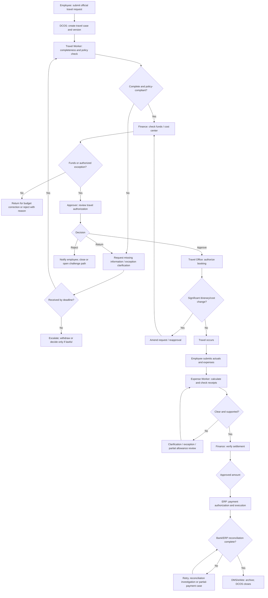

# PioOne V26 / KiDiS — Public-sector Travel-to-Reimbursement Workflow

**Document ID:** PIOONE-V26-KIDIS-TRAVEL-001  
**Version:** 1.0 (20 November 2026)  
**Status:** Functional and technical design specification — not proof of production implementation  
**Scope:** DCOS + KiDiS / PioOne Travel Management + PioWorker + PioBrain + Public Finance / ERP + DMS/eAkte

## 1. Purpose, boundaries and responsibilities

Travel-to-Reimbursement is a complete administrative case spanning an employee's travel request, rules check, budget reservation, legally competent authorization, booking, journey, expense submission, settlement, payment, and retention. Cases must support rejection, clarification requests, change requests, cancellation, incomplete claims, partial reimbursement, overpayment/recovery, and reopenings.

- **DCOS** owns orchestration: process instance, state transitions, assignments, timers, messages, escalations, version pinning, and correlation IDs.
- **KiDiS / PioOne Travel** owns the travel case UI, request forms, evidence references, and the employee/approver work queues.
- **PioBrain** supplies approved, source-attributed policy knowledge, rules explanations and supporting context; it is not the final authority for policy interpretation.
- **PioWorker** runs specialist, version-pinned digital tasks under policy constraints, with retriable/idempotent actions.
- **Public Finance/ERP** owns official cost centers, funds availability, expense settlement and payable/payment records; no second shadow ledger in DCOS.
- **HR / IAM** owns employment identity, manager/delegation relationship, employee status, and role authorization.
- **DMS/eAkte** owns managed documents, records retention, access and archive evidence.

## 2. Functional stages and gates

| ID | Stage | Primary owner | Digital worker | Entry/exit criteria | Human gate |
|---|---|---|---|---|---|
| TR-01 | Draft / submit request | Traveler | Travel Intake Worker | Traveler, reason, destination, planned dates, trip category, estimated costs, cost center, attachments. Submitted request receives immutable version and case ID. | No, except proxy-submission policy |
| TR-02 | Completeness and rules check | Travel Office | Travel Policy Worker | Check required fields, authorized journey category, travel rules, travel alternatives, estimated entitlements, conflict flags. Return for clarification if incomplete. | Conditional exception review |
| TR-03 | Funds and budget check | Budget holder / Finance | Budget Worker | Validate cost center, remaining funds, commitment window and thresholds via Finance API. Store reference, not duplicated finance truth. | Conditional budget authorization |
| TR-04 | Travel authorization | Delegated manager/authorized official | Approval Routing Worker | Verify delegated authority, submitted version, policy flags, budget reference. Approve, reject, return, or escalate with reason. | **Required unless documented policy expressly exempts** |
| TR-05 | Authorized booking and change management | Travel Office / Traveler | Booking Worker | Book only permitted options, record booking/booking reference and approved estimate. Material changes create an amended request requiring applicable reapproval. | Conditional booking/exception approval |
| TR-06 | Journey and expense submission | Traveler | Expense Capture Worker | Record actual start/end, itinerary, transport, advances, provided meals, receipts, personal extensions and claim submission. | Traveler attestation / submission |
| TR-07 | Expense verification and settlement calculation | Travel Office / Finance | Expense Rules Worker | Document verification, duplicate detection, mileage/allowances and deductions via jurisdiction-specific versioned rule profile; create calculation explanation. | **Required Finance/Travel reviewer** |
| TR-08 | Reimbursement release and reconciliation | Finance / authorized payment officer | Payment Preparation Worker | Create payable/settlement in ERP; dual control as configured; handle partial payment, withholding, overpayment, failed payment. Close only after ERP payment reconciliation is confirmed. | **Required authorized payment release** |
| TR-09 | Record retention and closure | Records Officer / Travel Office | Records Worker | Complete document index, approval chain, policy/version snapshots, accounting references and retention classification. Close, with reopen/appeal links where applicable. | Conditional records exception |

**Do not equate an approved travel request with an approved expense claim:** they are distinct decisions made at different stages.

## 3. BPMN-style primary and exception paths

## 4. Role-based access and separation of duties

| Role | Submit/edit | Review/approve | Finance/pay | Archive/audit |
|---|---|---|---|---|
| Traveler | Create and edit own drafts; submit corrections | Cannot self-authorize without a documented legal exemption | View own claim outcome, no bank release | View own permitted records |
| Line manager / delegated approver | Read assigned request scope | Authorize travel only within delegation and threshold | No payment release merely because they approved travel | View approval evidence |
| Budget holder | Budget reference and allocation comments | Approve budget reservations within limits | No direct employee reimbursement solely from budget role | View finance-linked records |
| Travel Office | Check policy, booking and receipts | Propose and review travel expense calculation | Cannot unilaterally execute payment | Transfer case record to DMS |
| Finance verifier | Read settlement details | Verify payable amount, deductions, advances | Approve accounting controls where assigned | Review payment references |
| Finance payment officer | Read authorized claim | Independent payment authorization per local rules | Execute/reconcile payment via ERP | View accounting evidence |
| HR / IAM administrator | Maintain identity and delegations | No business approval implied | No payment authority | Administration audit only |
| Records officer / auditor | No unilateral content edits | No substantive travel approval | No payment release | Retention, audit and lawful access |
| PioWorker / DCOS service principal | Task-limited reads and permitted drafts | No human-signature impersonation | No unrestricted payment execution | Append to server audit through controlled API |

Enforce ABAC/RBAC server-side by tenant, organization, department, record owner, classification, approval scope, delegation dates and spending thresholds. Delegation is time-bound, evidence-backed, revocable and checked again at approval execution. A requester cannot approve their own request merely by switching their UI role.

## 5. Data model

### 5.1 Core records

- `TravelCase`: `id`, `tenantId`, `organizationId`, `caseNumber`, `requesterId`, `onBehalfOfId?`, `departmentId`, `costCenterId`, `workflowDefinitionId`, `workflowVersion`, `policyProfileId`, `policyProfileVersion`, `status`, `stage`, `createdAt`, `submittedAt?`, `plannedStartAt`, `plannedEndAt`, `actualStartAt?`, `actualEndAt?`, `claimSubmittedAt?`, `closedAt?`, `deadlineSetId`, `confidentialityClass`, `rowVersion`.
- `TravelRequestVersion`: `id`, `caseId`, `versionNumber`, `destination`, `tripPurpose`, `tripType`, `transportMode`, `estimatedCost`, `currency`, `lodgingDetails?`, `personalTripSegment?`, `requiresPreApproval`, `submittedBy`, `submittedAt`, `requestFingerprint`.
- `BudgetCheck`: `id`, `caseId`, `financeReference`, `costCenterId`, `amount`, `currency`, `validUntil`, `result`, `authorizedBy?`, `timestamp`.
- `ApprovalDecision`: `id`, `caseId`, `gateId`, `requestVersion`, `approverId`, `delegationReference?`, `role`, `decision`, `reason?`, `decisionAt`, `policySnapshotReference`, `signatureEvidenceReference?`.
- `Booking`: `id`, `caseId`, `bookingProviderRef?`, `bookingType`, `estimatedAmount`, `actualAmount?`, `status`, `amendmentVersion`.
- `ExpenseClaim`: `id`, `caseId`, `claimVersion`, `claimantId`, `submittedAt`, `periodStart`, `periodEnd`, `attestationAt`, `expenseLines[]`, `advanceAmount`, `claimAmount`, `calculatedEntitlement`, `approvedEntitlement`, `currency`, `calculationVersion`.
- `ExpenseLine`: `id`, `category` (transport, lodging, meals, mileage, incidentals, other), `description`, `occurredAt`, `amount`, `currency`, `receiptRef?`, `ruleResult`, `deductibleAmount`, `eligibleAmount`, `flags[]`.
- `PaymentReference`: `id`, `caseId`, `erpPayableId`, `requestedAmount`, `approvedAmount`, `paidAmount`, `paymentStatus`, `paymentBatchRef?`, `reconciliationRef?`, `paidAt?`.
- `CaseEvent`: `eventId`, `tenantId`, `caseId`, `occurredAt`, `actorType`, `actorId`, `serviceId?`, `action`, `previousState`, `newState`, `reason?`, `resourceRefs[]`, `correlationId`, `causationId`, `idempotencyKey`, `workflowVersion`, `policyVersion`.

### 5.2 Relationships and consistency

`TravelCase 1→N TravelRequestVersion`, `TravelCase 1→N ApprovalDecision`, `TravelCase 1→N Booking`, `TravelCase 1→N ExpenseClaim`, `ExpenseClaim 1→N ExpenseLine`, `TravelCase 1→N CaseEvent`, `TravelCase 0→N PaymentReference`. All references are tenant-scoped. Employee identity is resolved through HR/IAM; cost center and payable balances are resolved from ERP. Documents are kept in DMS/eAkte, referenced by stable document/version IDs; avoid duplicating raw personal documents in DCOS.

Currency amounts use decimal or integer minor units, not floating-point. Timestamps are UTC with the organization time zone retained separately. Audit must be append-only, integrity-protected and independent of local browser storage.

## 6. Case states, actions and event semantics

**Primary states:** `DRAFT`, `SUBMITTED`, `POLICY_REVIEW`, `AWAITING_INFORMATION`, `BUDGET_REVIEW`, `AWAITING_TRAVEL_AUTHORIZATION`, `AUTHORIZED`, `BOOKING`, `IN_TRAVEL`, `AWAITING_EXPENSE_CLAIM`, `EXPENSE_REVIEW`, `EXPENSE_RETURNED`, `PAYMENT_PENDING`, `PARTIALLY_PAID`, `PAYMENT_EXCEPTION`, `RECONCILED`, `CLOSED`.

**Terminal / side-path states:** `REJECTED`, `WITHDRAWN`, `CANCELLED`, `ARCHIVED`, `REOPENED` (transitional), `DISPUTED`. Cancellation after bookings or travel may still create cancellation-expense and recovery subcases; do not erase financial obligations.

**Commands:** `SubmitTravelRequest`, `RequestInformation`, `SupplyInformation`, `RecordBudgetDecision`, `ApproveTravel`, `RejectTravel`, `AmendTravel`, `RecordBooking`, `SubmitExpenseClaim`, `ReturnExpenseClaim`, `ApproveSettlement`, `ReleasePayment`, `ConfirmReconciliation`, `CloseCase`, `ReopenCase`. Commands require authorization and unique idempotency keys; asynchronous events from ERP and booking services must be correlated and deduplicated.

## 7. Branch decisions and exception matrix

| Condition | DCOS action | Human responsibility |
|---|---|---|
| Required field/document missing | `AWAITING_INFORMATION`, request with evidence and response date | Traveler supplies information; case officer decides final consequence |
| Policy exception / unusually expensive trip | Escalate to specialized approver and capture exception reason | Authorized officer determines whether exception is permitted |
| Budget unavailable | Return for alternate cost center, authorized exception, or reject | Budget authority signs decision |
| Approver absent / delegation expired | Re-route to documented substitute; never default auto-approve | Valid delegate or next authority approves |
| Request materially changed after approval | New request version and recheck of relevant rules, budget and approvals | Original or competent replacement approver reviews changed version |
| Trip cancelled | Record cancellation and vendor fees; open settlement/recovery subcase if needed | Travel Office/Finance authorizes treatment |
| Missing receipt | Flag document and rule-specific permitted alternatives | Finance reviewer accepts or rejects evidence with rationale |
| Claim exceeds estimate | Compare tolerance and actual costs; route to budget/finance review | Authorized budget/finance decision |
| Partial reimbursement | Create approved/disallowed line explanation; notify traveler and retain review path | Finance verifier approves exact amount |
| Overpaid advance / negative settlement | Create recovery/refund case and appropriate finance references | Finance authorizes lawful recovery |
| Failed payment / incomplete reconciliation | `PAYMENT_EXCEPTION`; retry with idempotency safeguards, reconcile safely | Finance resolves payment issue |
| Deadline exceeded | Notify and escalate; flag potential exclusion, not automatic legal rejection | Authorized case officer determines legal effect |
| Alleged incorrect decision | Create review/reopen route with linked event history | Competent reviewer adjudicates |

## 8. Deadlines and notification rules

Deadline engine stores `clockType` (`legal`, `policy`, `internalSLA`), `startEvent`, `duration`, `calendar`, `timezone`, `pauseRules`, `sourceLegalRuleId`, `policyVersion`, `warnAt`, `escalateAt`, and `decisionOnMiss`. Legal deadlines must not be changed by an ordinary UI editor; source and effective date must be reviewed by legal/HR staff.

For **German federal** travel reimbursement, BRKG § 3(2) establishes a six-month claim exclusion period after the end of the trip. Bavarian law has its own rules, including BayRKG Art. 3(5) and the relevant scope of personnel. Always select the correct jurisdiction and employment category; never assume federal rules govern every municipality or employee category. See https://www.gesetze-im-internet.de/brkg_2005/__3.html and https://www.gesetze-bayern.de/Content/Document/BayRKG-3.

Recommended *configurable, illustrative* internal service targets (not statutory deadlines): initial completeness check within two working days, approver reminder after two days, escalation after four days, expense verification target within five working days, reconciliation follow-up after two working days. These are defaults only when explicitly adopted by the organization.

When a required legal deadline is near: reminders at configured thresholds; never substitute a reminder for required official notification. A missing action can lead to escalation, suspension under a lawful rule, or documented manual review — never auto-approval or automatic claim denial simply because a software timer fired.

## 9. Worker designs, tools and trust boundaries

| Worker | Input | Allowed outputs | Forbidden autonomous action |
|---|---|---|---|
| Travel Intake Worker | request, employee context | clean draft, checklist, case metadata | approve or act as traveler without consent |
| Policy Worker | jurisdiction/versioned travel rules | cited rule assessment, exceptions, checklist | make binding legal decision |
| Budget Worker | budget API query | availability reference, threshold flags | commit funds outside Finance authorization |
| Approval Routing Worker | org chart, delegation API | eligible approver set, reminders | self-approve, impersonate signatory |
| Booking Worker | authorization, allowed catalog | booking proposal or permitted API action | book outside delegated spending limits |
| Expense Capture Worker | OCR receipts, expense lines | structured lines and extraction confidence | create payments or hide receipts |
| Expense Rules Worker | versioned policy profile and actual itinerary | explainable settlement draft and flags | final approval or silent recalculation after sign-off |
| Payment Preparation Worker | signed settlement and ERP refs | payable draft and reconciliation request | release payment without finance controls |
| Records Worker | case references and events | retention classification and archive package | independently purge records |

Each worker assignment uses immutable `workerDefinitionId`, `workerVersion`, tool allowlist, budget, tenant and case scope; external access must be disabled unless authorized. Every worker suggestion is traceable to source documents and policy versions, with a confidence indicator and fallback to manual review.

## 10. KiDiS / PioOne V26 Web UI

### Routes and navigation

- `DCOS > Workflow Center > Internal Administration > Travel-to-Reimbursement` — template overview and start process.
- `Travel Management > My Trips` — traveler requests and expense claims.
- `Travel Management > New Request` — wizard with six sections: itinerary, purpose, traveler, financials, attachments, summary/attestation.
- `DCOS > My Approvals` — assigned authorization or settlement approvals (separate gate types).
- `DCOS > Workflow Runs > TR-...` — case progress, decision history, exceptions and timeline.
- `Travel Office > Review Queue` and `Finance > Settlement Queue` — role-scoped worklists.
- `Administration > Workflow Builder` — versioned stages, legal/policy profiles, routing and timers (admin only).

### Case page tabs

1. **Overview:** case ID, traveler, organization/department, cost center, destination/dates, stage, status, pending approver, deadline and totals.
2. **Itinerary & Requests:** approved/submitted versions, travel purpose, approved allowances and deviations.
3. **Approvals:** who approved what, exact document and request version, delegations, rejection/change reasons.
4. **Booking:** bookings, confirmation IDs, cancellations and supplier references.
5. **Expenses:** OCR extraction, receipts, eligible lines, advance offset, amount requested/approved/paid and explanation of differences.
6. **Activity & Audit:** immutable server events, timestamps and actor types, export controlled by role.
7. **Documents:** links to DMS/eAkte, templates, official notices and archive evidence.

UI buttons change based on server-returned permitted actions, **not** only a user-selectable UI role. Display version conflicts clearly; optimistic edits are rejected if a newer request version exists. Financial buttons require an explicit final confirmation and render exact committed amount and payee from ERP.

### Suggested widgets

Employee: upcoming travel, drafts, authorizations pending, missing documents, claims and reimbursement status.  
Manager: pending decisions, spend estimate versus budget, delegate availability.  
Travel Office: incomplete requests, policy exceptions, bookings, receipts needing review.  
Finance: unpaid authorized settlements, partial payment, reconciliation exceptions.  
Leadership: volume, median cycle time, late claims, approval bottlenecks, reimbursement time and costs by cost center, only in permitted aggregated form.

## 11. Interfaces and API contracts (proposed)

Prefer the existing PioVation Go/gRPC service convention within the private backend; UI may use a secure gateway/adapter appropriate to its deployed architecture. Proposed operations:

- `TravelService.CreateDraft`, `SubmitRequest`, `AmendRequest`, `GetCase`, `ListCases`, `SubmitExpenseClaim`.
- `WorkflowService.StartWorkflow`, `GetRun`, `GetAllowedActions`, `GetHistory`, `SignalExternalEvent`.
- `ApprovalService.ListAssigned`, `Decide`, `Delegate`; server validates decision rights, exact record version and signature.
- `PolicyService.EvaluateTravel`, `CalculateExpenses`, `GetEffectiveRuleProfile`.
- `FinanceAdapter.CheckBudget`, `ReserveBudget`, `CreatePayable`, `GetPaymentStatus`, `ReconcilePayment`.
- `DocumentAdapter.UploadEvidence`, `GetDocumentVersion`, `ArchiveCase`.
- `NotificationService.SendTask`, `SendReminder`, `RecordDelivery`.

All writes require `tenantId`, authenticated actor, correlation ID and idempotency key. For long-running steps, use durable signals/commands, retries, dead-letter handling and compensation (e.g. booking cancellation, payment review). Events must not authorize a new payment without a second server-side validation of approved amount, budget and payee.

## 12. Security, compliance and data minimization

Use minimal personal and financial data, role-scoped document access, encryption in transit and at rest, secure audit and segregation of duties. Treat travel destinations/itineraries and expense documents as potentially sensitive. Avoid using actual personnel data in demos. Use local authority's retention schedule and DMS/eAkte classification, not a single global purge interval. Define a records export and migration path to limit lock-in. Maintain human review of consequential decisions and transparent use of AI-generated recommendations.

## 13. Acceptance tests

- T01: employee submits complete request; unique case and immutable version are created.
- T02: missing document returns case for information without losing prior evidence; replay is safe.
- T03: manager cannot approve own request when forbidden by policy; unauthorized user gets server-side denial.
- T04: delegated approval works only within effective dates, delegated scope and budget limit.
- T05: itinerary amendment after approval requires rule/budget recheck and relevant reapproval.
- T06: required travel authorization must occur before booking action.
- T07: submitted expense totals and original receipts remain reproducible across calculation rule versions.
- T08: partial approved reimbursement carries line-level reasons and cannot be silently rounded or changed.
- T09: payment fails; retries do not create duplicate ERP payable or duplicate bank instruction.
- T10: ERP reconciliation only closes the case when paid amount and authorized settlement are accounted for.
- T11: cancellation after booking starts a cancellation-expense review rather than deleting liability.
- T12: clock profiles reflect selected jurisdiction, employee category, travel end date and working-day calendar.
- T13: statutory deadline miss triggers review, not automatic denial without competent human decision.
- T14: cross-tenant record requests are rejected even for guessed case IDs.
- T15: unapproved worker version cannot be assigned to a new workflow; existing pinned version remains stable.
- T16: archive includes traceable versions, approvals, settlement, payment references and audit chronology.
- T17: UI distinguishes draft, awaiting approval, returned for details, expense review, partial payment and closed states.
- T18: audit is tamper-evident, queryable by authorized auditors and not editable through browser localStorage.

## 14. V26 delivery plan and current implementation boundary

**Already represented in V26 prototype:** Travel-to-Reimbursement nine-stage template, internal-public workflow library, case reference/department/due date metadata, demo approval gates, simulated rejection/return/resume, local demo audit, generic workflow builder and analytics.

**Not yet implemented:** legally verified travel rule profiles, delegated role authorizations, traveler/manager/finance work queues, expense line/receipt ledger, booking adapters, ERP budget/payments, deadline engine, signed evidence, immutable server audit, DMS/eAkte adapter, branch-aware durable runtime. These require dedicated engineering and integration rather than simply extending the frontend status enum.

Implementation increments:
1. V26.1: dedicated travel form, case details, state/branch UI, local illustrative fixture data and test coverage.
2. V26.2: gRPC backend contracts, organization/role/tenant model, persistent event history and delegated authorization.
3. V26.3: finance and DMS integration, configurable jurisdictional expense rules, deadline engine and integration testing.
4. Production readiness: external security review, per-authority policy validation, signed acceptance criteria, integration/E2E tests and deployment sign-off.

**References:** Federal Travel Expenses Act, BRKG § 3 and related provisions: https://www.gesetze-im-internet.de/brkg_2005/__3.html. Bavarian Travel Expenses Act, BayRKG Art. 3: https://www.gesetze-bayern.de/Content/Document/BayRKG-3. Local implementing rules and other federal-state/municipal arrangements must be verified for each deployment.
