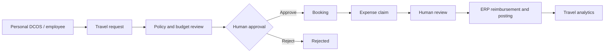

# PioOne V14 — Travel Management specification

**Status:** UI prototype and incremental product specification. Baseline: supplied PioOne V13 React source and README. V13 README remains the reference for unchanged functions; the standalone V11/V13 full specification was not supplied. This document specifies the V14 delta, not a reconstructed full platform specification.

## 1. Product placement
Travel Management is an independent enterprise application under Apps, next to CRM, ERP, HR and Projects. It owns the business-trip lifecycle; HR owns employee master data and existing non-travel expenses; ERP owns accounting, payments and cost centers; Projects owns project budgets; Document Processing owns receipt capture. Personal DCOS is the employee interface and coordinates functional workers. No duplicate financial posting is intended.

## 2. Module catalog and worker responsibilities

| Module ID (prefix `Travel Management/`) | Functional worker | Target responsibility |
|---|---|---|
| Travel Requests | Travel Request Worker | Prepare itinerary, dates, purpose, estimated cost, cost center and project; submit for approval |
| Travel Approvals | Travel Approval Worker | Check policy, budget and approval route; prepare decision for authorized human |
| Travel Booking | Travel Booking Worker | Compare authorized travel options, prepare booking and record confirmations |
| Travel Expenses | Travel Expense Worker | Collect receipt references, reconcile actual expenses, prepare reimbursement and accounting payload |
| Travel Policies | Travel Policy Worker | Evaluate travel rules, thresholds, exceptions, effective dates and audit evidence |
| Travel Analytics | Travel Analytics Worker | Aggregate spend, approval times, budget variance and travel patterns within authorized scope |

Registry display names follow the existing V13 convention `Travel Management · <module> Worker`. Each position has a distinct module ID and default template with published demo version 1.0.0. Administrators can bind a different worker and choose latest published or pinned release in Settings. Digital Organisation shows each enabled, entitled, purchased module position. Worker assignments do not grant access or execute work. Personal DCOS remains one identity per employee.

## 3. UI and process

Apps → Travel Management → six module tabs (only allowed modules). Header shows resolved worker and release, plus Ask DCOS. Shared local trip register is organization-scoped. Each view exposes visible-scope metrics. Request form: destination, purpose, departure, return, estimated EUR cost, cost center and optional project. Booking records a manually entered confirmation reference. Expense form records one total and receipt reference. Policies support a budget review threshold, recommended notice period and receipt-reference requirement. Analytics is a scoped register with totals, not a full BI suite.

Production target illustrated above; V14 simulates only local state transitions. Status lifecycle: Draft → Submitted → Approved or Rejected; Approved → Booked → Expense submitted → Settled. Rejection is terminal in this prototype. Settled is a local review marker, not actual payment. Budget and notice checks are warnings; receipt reference is enforced on expense submission when required. No automatic approval or booking.

## 4. Access and organization

Enterprise includes the full catalog; Business remains unchanged by default. Other packages can purchase/configure modules through existing entitlement and add-on UI. Organization/module grants and worker grants remain separate. Fresh demo Sales has Requests, Booking and Expenses; HR and Finance have all six. Tenant admin sees all organization trips. Employee sees own trips; team leader can review trips belonging to a team they lead, subject to module access. Self-approval and self-settlement are blocked. Only tenant admin edits policy. Existing platform/tenant role switch is illustrative; team and department workspace selectors are not security boundaries. In this prototype a tenant admin can review another employee's claim; production must require explicit finance approval permission and separation of duties. No group aggregation.

## 5. Integration contracts (target, not implemented)

| System | Data / action | Ownership |
|---|---|---|
| HR | Employee ID, manager, department, employment status | HR |
| ERP | Cost center validation, budget commitment, expense ledger, reimbursement status | ERP |
| Projects | Project ID, chargeability, budget allocation | Projects |
| Document Processing | Receipt ingestion, extracted fields, document ID, verification | Document Processing |
| Booking provider | Search, quote, booking, cancel, confirmation | Provider; travel service orchestrates |
| Calendar | Approved travel dates, itinerary | Calendar |
| DCOS / worker registry | Task delegation, worker version, human gate | PioOne orchestration |

Proposed service boundary: TravelService with CreateTrip, SubmitTrip, DecideTrip, RecordBooking, SubmitExpense, ReviewExpense, GetTrip, ListTrips, GetPolicy, UpdatePolicy, GetTravelAnalytics. Prefer authenticated gRPC through the platform gateway. Use tenant/organization/user context from verified identity, server-side permission enforcement, idempotency keys for mutating requests, optimistic versioning, immutable audit events with worker release and human actor, and explicit booking/payment consent. No real provider endpoints or credentials are supplied.

## 6. Production data model and governance
Trip: tenant/organization, trip ID, traveler ID, destination, purpose, dates/timezone, cost center, project, currency, estimate, state, version, timestamps. Approval: decision, reviewer, reason, policy version and budget check. Booking: provider, itinerary, reference, status, price and cancellation terms. Expense: itemized amounts, currencies, FX, tax, allowances, receipts, payment/posting IDs. Policy: effective date, country/role/transport rules, thresholds, exceptions, approval chain. All production records require retention, deletion, access logging and privacy controls; passport/payment/medical data must not be stored in local browser demo. German travel tax, per diem and reimbursement rules are not implemented or specified as legal determinations.

## 7. Release / acceptance criteria
- Catalog has 13 applications, including six Travel modules; existing module IDs remain intact.
- Travel tabs respect module entitlement, activation and grants; all six worker positions derive from catalog.
- Test create draft, invalid dates/budget, submit, reject with reason, approve as another authorized user, booking reference, expense submission with required receipt, non-self review and persistence after reload.
- Test denial of self-approval, unauthorized module access and cross-organization access; test latest/pinned release resolution and unavailable retired version.
- Production gates: server-side authorization, cross-tenant tests, approval audit trail, transactional idempotency, actual provider and ERP sandbox integration, accessibility and browser regression tests.

## 8. Migration and validation
V14 storage is isolated under `pio14-`; no migration from V13. Existing HR Expenses is retained. The supplied archive had no standalone full specification, so this is an additive specification and README update. TypeScript syntax transpilation was checked; a full dependency-based build, type check and browser workflow test were not completed because npm dependencies are not cached in the environment. No claim of production readiness.
