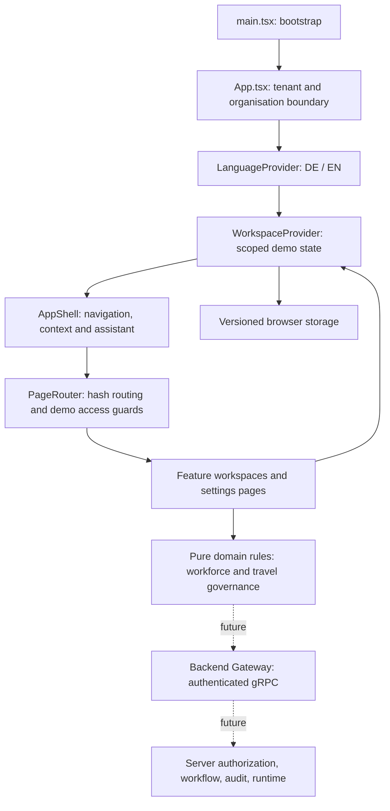
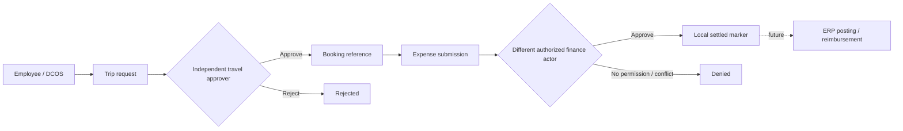

# PioOne V15 – Architecture & Governance Release

**Status:** React demonstration and architecture increment, not a production release. **Baseline:** V14 React archive and its specification. V14 functional scope is retained in source. This document supersedes V14 on the topics explicitly changed below; the included V14 specification remains the reference for unchanged Travel requirements.

## 1. Release scope

V15 retains all 13 applications and 92 module IDs. It focuses on component boundaries, navigation, shared client state, human accountability, explicit version selection, German/English presentation and stricter illustrative travel approval. No live worker, provider, ERP, identity provider, authorization service or financial calculation engine is introduced. PioOne is positioned as an AI-native enterprise operating system for a hybrid workforce; the UI demonstrates that operating model rather than asserting live automation.

## 2. Architecture

- `src/main.tsx`: minimal React bootstrap (186 bytes); no domain rendering or state.
- `src/app/App.tsx`, `AppShell.tsx`: tenant/organisation lifecycle and global shell. Shell still contains global navigation, assistant panel and composer UI.
- `Router.ts`, `routeRules.ts`, `PageRouter.tsx`: encoded hash routes, browser history, module and section validation and client demo guards. The hash route is not a security boundary. Canonical route example: `#/Apps/Travel%20Management%2FTravel%20Expenses`.
- `src/stores/WorkspaceStore.tsx`: one typed Context provider and scoped persistence. Feature pages consume the context instead of receiving a large workspace prop tree. It remains a shared model, not yet independently subscribed domain stores. Travel maintains its own local form and organisation-scoped register. Future decomposition: session, organisation, entitlement, workforce, travel and communication stores with selectors and API adapters.
- `src/features/`: communication, home, DCOS, PioChat, apps, organisation, capture and settings views are extracted. Settings subpages are separate components. Generic business module CRUD remains a common workspace, not 92 production applications. Some specialised components retain bounded props and local state.
- `src/core/`: pure workforce and approval rules plus workspace storage helpers.
- `src/locales/`: dictionaries, language context and header switch. No additional routing/store/i18n dependencies are required; this increment intentionally uses React and browser-native capabilities rather than introducing Zustand, React Router or react-i18next before an install/build can be validated.

## 3. Workforce semantics and counting

| Entity | Meaning / implementation |
|---|---|
| Human employee | Directory person; counted once per person ID. |
| Personal DCOS | Derived personal digital identity per employee; owner is the linked person; independent worker version binding. |
| Digital position | Organisational role with accountability fields; can own multiple module assignments. |
| Worker definition | Registry template defining a worker identity and available releases; distinct from headcount. |
| Worker version | Draft/published/retired release with endpoint and notes; a published release is not proof of live deployment. |
| Worker assignment | Module ID linked to a digital position and a separately configured worker/version binding; optional individual accountability override. |
| Worker instance | Modelled runtime concept with instance ID, assignment ID, worker ID, release and state; no actual runtime telemetry is connected. |

Fresh demo seed: 13 functional positions (one per application), 92 module assignment records, one default module worker definition/binding for every module plus existing shared worker definitions. Personal DCOS identities are derived from directory users. Organisations can add positions and remap modules to them. This default is an organisational grouping decision, not a claim that there are 13 live employees. Counts distinguish functional positions, personal DCOS, module assignments, worker definitions, resolved bindings and runtime instances. Running instance count is zero in the local demo. Displayed module assignment/position counts may reflect the active/entitled scope. No definition or assignment count is to be presented as actual employee headcount. No execution or automatic access is conferred by a position or binding.

## 4. Human accountability

Settings → Digital positions provides editable position name on creation, accountable owner (person ID), responsible role, department, supervisor, approval authority, escalation owner, execution policy and audit policy. Position details can be incomplete; the demo marks them as not production ready. No fictitious owner is pre-assigned. The Module Workers profile exposes the linked position, the module-level accountable owner override, inherited owner and readiness. Personal DCOS continues to have an accountable person via the human directory link. The model uses IDs for persons; role/department/policy fields are illustrative text. The demo readiness test checks that owner, supervisor and escalation owner resolve to directory people and that role, department and approval authority are nonempty. It does not certify compliance, validate a role catalogue or enforce permissions.

Production gate: require a resolved, active, authorized accountable human, verified roles and scoped grants, defined supervision and escalation, approved policy and version, an approval authority distinct where required, and evidence of periodic review. Reject activation with missing or invalid accountability. Retain responsibility history with effective timestamps, changes, approvals and actor identity. A module owner override must not bypass inherited controls. No reference to regulator approval or compliance certification is implied.

## 5. Worker version lifecycle

Default module bindings and personal DCOS seed bindings pin release `1.0.0` (or the available published release on new assignment). Publishing a new version does not update an existing pinned binding. Explicit pin change can promote or roll back a binding. The legacy latest-published mode remains available for demonstration/preview; it is not safe for controlled production deployment. Retiring a pinned release leaves it unresolved. Registry permissions and publication are client-only demonstrations. Production requires version artifacts and checksums, signed approvals, immutable release history, separate release promotion authority, policy compatibility tests, effective deployment records and rollback audit.

## 6. Travel Management and separation of duties

Travel remains an independent application with Requests, Approvals, Booking, Expenses, Policies and Analytics. Existing V14 trip states and V14 module IDs are retained. Travel approval cannot be performed by the requester and requires the demo's authorized tenant administrator or team leader. The approver's person ID is recorded. Expense settlement requires all of: a distinct claimant, a recorded different travel approver, a distinct finance actor, explicit finance permission configured in Digital positions, membership in Finance, and access to the expense module. The finance reviewer ID is recorded. An administrative role alone is not enough for expense settlement. Fresh demo finance grants are empty; an administrator must deliberately configure eligible users. Claims without a recorded travel approver cannot be settled. These are browser-local demonstrations, not authenticated financial approvals. No live transfer, payroll or accounting posting is performed.

### Production Travel engine (not implemented)

Treat statutory, tax and organisational policy calculation as a separate domain project, with legal/finance subject matter review. Scope includes the applicable policy/legal regime (e.g. BRKG only where applicable; employer travel policy and tax law where applicable), domestic and foreign per-diem schedules, meal deductions, accommodation, mileage, multi-day and cross-border time rules, actual expenses, receipts, currencies and FX, tax and payroll implications, exception approvals and correction/reversal. Every calculation must bind to versioned effective-dated rules and inputs and output an explainable line-item trace. Different employers and jurisdictions may use different rules. No rate, legal rule or tax outcome is represented by this release. Build regression fixtures validated by finance/legal experts; integrate HR, ERP, payroll, projects and receipt processing via authorized interfaces. Budget warning, receipt reference and manual booking are still illustrative.

## 7. Language and UX

A header DE/EN selector persists the UI preference. Central dictionary maps display strings, app/module labels and common statuses; canonical IDs and stored data are unchanged. Travel currency formatting follows the selected locale. Static visible UI text and many dynamic labels are translated; remaining dynamically assembled messages, generated demo names/content, full date formatting and accessibility language review require further localization/regression work. English fallback is deliberate. No guarantee of exhaustive bilingual coverage is made without a browser review.

## 8. Security and backend target

The UI demonstrates configuration and expected behavior. All localStorage data, role switch, module guards, permissions and workflow states are editable by a browser user. No confidential or real employee data should be entered. Backend must derive tenant, organization and actor from verified identity, enforce RBAC/ABAC and scoped resource grants, validate state transitions and human approvals on every command, use transactional idempotency and optimistic concurrency, record immutable audit events (including decision, policy version, worker release, actor, correlation ID and timestamp), support delegation, retention, privacy, isolation and deny-by-default. The PioSphere COS runtime is responsible for controlled worker execution and telemetry. Prefer authenticated gRPC via Backend Gateway; no API is wired here.

Target boundaries: WorkforceService (positions, accountability, assignments), WorkerRegistryService (releases, approval, deployment), AuthorizationService (policy and resource decisions), TravelService (requests, approvals, expenses), AuditService (append-only evidence). Separate application/worker permissions. Never interpret hidden UI actions as enforced authorization.

## 9. Validation and acceptance

Performed in this environment: TypeScript syntax transpilation across 46 TS/TSX files; isolated type check with temporary React/lucide declarations (not equivalent to installed dependency type check); model assertions over all 92 module routes, seed counts, version pinning, accountability readiness and travel separation-of-duties. `npm run test:model` reproduces domain assertions after dependencies are installed. The npm registry is unavailable in the build environment; full dependency-based build and browser regression were not run. The original V14 UI flows have been retained in source, not verified end to end. A complete release gate must include `npm install`, `npm run build`, browser smoke tests, direct URL/back-forward navigation, 13 apps/92 routes, role/tenant switches, worker version updates, digital position reassignments, language toggles, travel end-to-end positive/negative tests, accessibility and visual review. No claim of production readiness.

## 10. Storage and roadmap

V15 uses its own `pio15-` storage namespace and does not modify/migrate V14 browser records. Language preference is `pio15-language`. Reset demo clears V15 data only. Existing V14 demo data stays in V14. V16: domain-store decomposition, typed API contracts, server auth/audit, end-to-end testing. V17: production Travel policy and calculation engine with finance/payroll integration. V18: worker deployment, version approval and runtime instances. Release dates and regulator readiness require separate validation.
