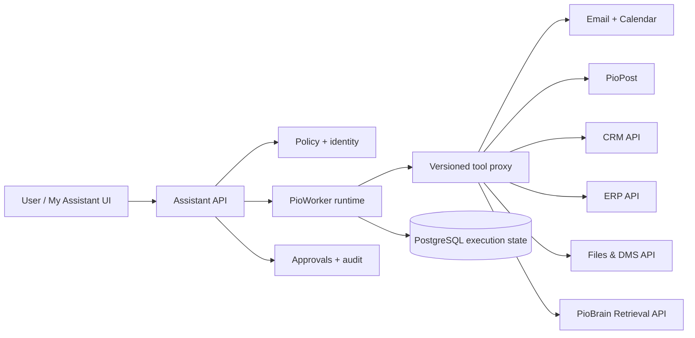
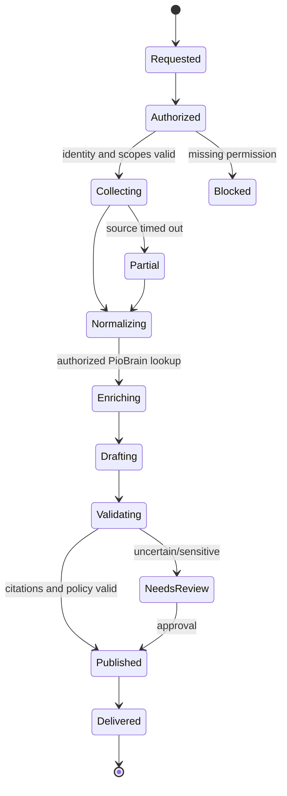

# My Assistant / DCOS — Implementation Specification (V32.5 target)

**Status:** Proposed backend implementation. V32.5 currently implements a React UI prototype. The visible product label is **My Assistant**; **DCOS** remains an internal concept/identifier where already used by the application.

## 1. Goals and scope

My Assistant is each employee's personal digital chief of staff. It uses approved company applications and user-authorized personal information to answer questions, prepare morning briefings, propose actions, run controlled workflows, monitor delegated tasks and coordinate specialist PioWorkers. It operates alongside people; sensitive or legally binding decisions require a human approval gateway.

### Primary functions

- Personalized home/briefing: priorities, calendar, mail, scanned incoming post/PioPost, open CRM opportunities, ERP cash/invoice alerts, tasks, approvals, contracts and travel.
- Chat and contextual search over source-grounded business data and permitted PioBrain knowledge.
- Workflow assistant: initiate and track Lead-to-Cash, Procure-to-Pay, Hire-to-Retire, Request-to-Resolution and public/internal workflows.
- Specialist worker delegation: explicit worker identity, app/module binding, policy, version, budget, tool allowlist and responsible supervisor.
- Follow-ups, reminders, email drafts, task suggestions, meeting preparation and approval inbox.
- User controls: language, time zone, notification channels, connected sources, personal-drive grants and activity history.

**Out of scope:** Becoming the system of record for CRM, ERP, contacts, original documents or accounting; unrestricted database access; silent AI-initiated payment, binding contract execution or external messages.

## 2. Runtime architecture



Browser calls authenticated gateway API; internal services may use Go/gRPC with mTLS. Worker tools are explicitly registered (name, version, input/output JSON schema or protobuf, scopes, timeout, retry, allowed side effects, compensation). Workers use **on-behalf-of user** authorization, not a privileged backend DB connection. PioBrain only returns results authorized against original source.

## 3. Data structures

All rows tenant-scoped with composite tenant-safe FKs, timestamps, creator ID and audit correlation.

| Table | Required fields and invariants |
|---|---|
| `assistant.profiles` | id, tenant_id, user_id, name, locale, time_zone, enabled, UNIQUE(tenant_id,user_id) |
| `assistant.preferences` | id, tenant_id, user_id, briefing_schedule, sections_json, sensitivity_policy, notification_channels_json, revision |
| `assistant.worker_assignments` | id, tenant_id, user_id, worker_definition_id, pinned_version, policy_revision, status; admin-controlled |
| `assistant.source_connections` | id, tenant_id, owner_id, integration_id, provider, scopes_json, state, last_sync_at; credentials via vault only |
| `assistant.knowledge_grants` | id, tenant_id, principal_id, resource_type, resource_id, purpose, permission, expires_at, revoked_at |
| `assistant.conversations` | id, tenant_id, owner_user_id, status, created_at, retention_policy_id |
| `assistant.messages` | id, tenant_id, conversation_id, sender_kind, content_ref, model_version, redaction_class, created_at |
| `assistant.briefings` | id, tenant_id, user_id, local_date, version_number, status, document_id, created_at, published_at, UNIQUE(tenant_id,user_id,local_date,version_number) |
| `assistant.briefing_sources` | tenant_id, briefing_id, source_system, source_record_id, record_revision, source_hash, citation_anchor, retrieved_at |
| `assistant.workflow_definitions` | id, tenant_id, code, version, stages_json, policies_json, published_at, checksum; immutable versions |
| `assistant.workflow_runs` | id, tenant_id, definition_id, definition_version, user_id, worker_id, worker_version, state, input_ref, checkpoint_ref, correlation_id |
| `assistant.tool_calls` | id, tenant_id, run_id, tool_id, tool_version, delegated_user_id, idempotency_key, request_hash, response_ref, state, started_at, completed_at |
| `assistant.approval_requests` | id, tenant_id, run_id, action_ref, approver_id, required_role, state, requested_at, decided_at, reason; immutable decisions |
| `assistant.memories` | id, tenant_id, user_id, consent_status, scope, content_ref, source_ref, expiry_at |
| `assistant.notifications` | id, tenant_id, user_id, briefing_id, channel, state, delivered_at, external_receipt |

Source documents stay in DMS, business facts in CRM/ERP. Persist only necessary run state, citations, references, encrypted summaries and approved user memory.

## 4. Morning briefing: end-to-end workflow



1. Trigger by user or configured schedule; resolve time zone and local date; idempotently start one run.
2. Resolve tenant, user roles, module access, worker version, tool grants and personal folder consents.
3. Fetch authorized sources in parallel: email priorities, upcoming meetings, PioPost correspondence, CRM stages/follow-ups, ERP receivables/payables, approvals, tasks, travel and DMS.
4. Normalize `BriefingCandidate` as `{domain,entity_id,revision,title,priority,due_at,source_ref,confidence,acl_tag}`; deduplicate and rank.
5. Ask PioBrain for background citations using user + purpose + allowed sources. Never infer an account balance from an embedding.
6. Compose sections: Overview, Urgent, Email & Post, CRM, Finance, Calendar, Tasks/Approvals, Suggested Actions; explicitly identify missing or stale connectors.
7. Validate source references and access again before publication; redact for notification channel.
8. Store an immutable versioned briefing artifact with source provenance, publish, deliver and audit.
9. Opening a briefing source rechecks current permissions; regenerating creates a new version, never silently overwrites old versions.

**Failures:** expired provider credentials, partial source timeout, inaccessible document, model failure, duplicate trigger, policy revocation, rerun/recovery after crash. Partial briefings show omissions and never claim all systems were checked.

## 5. Workflow and approval engine

Template = versioned ordered/DAG stages with input/output schema, role, worker/app binding, SLA, retry/compensation, required approval and audit requirements.

- **Lead-to-Cash:** CRM lead → opportunity → quote version → approval/acceptance → PioPakt contract → ERP order → delivery → issued invoice → reconciled payment.
- **Procure-to-Pay:** requisition → budget → supplier → purchase order approval → goods receipt → invoice three-way matching → payment approval → bank settlement.
- **Hire-to-Retire:** position → recruiting → offer → contract → onboarding → employment lifecycle → payroll/offboarding.
- **Request-to-Resolution:** request → classification → assignment → investigation → approval → resolution → closure.
- **Public workflows:** human decisions/official signatures remain with responsible public employees; worker prepares only authorized drafts.

Run state `queued → running → waiting_for_approval | waiting_for_external | completed | failed | cancelled`. Every transition is a transaction with outbox/audit event. Approval requires policy checks when decision is taken, not merely when a request is generated. Retries must use stable idempotency keys for side effects.

## 6. APIs

```http
POST /api/v1/assistant/briefings:generate
GET  /api/v1/assistant/briefings?date=YYYY-MM-DD
GET  /api/v1/assistant/briefings/{id}/sources
GET  /api/v1/assistant/preferences
PUT  /api/v1/assistant/preferences
POST /api/v1/assistant/conversations
POST /api/v1/assistant/conversations/{id}/messages
GET  /api/v1/assistant/runs/{id}
POST /api/v1/assistant/workflows/{template_id}:start
POST /api/v1/assistant/runs/{id}:cancel
POST /api/v1/assistant/approvals/{id}:decide
GET  /api/v1/assistant/connectors
POST /api/v1/assistant/knowledge-grants
DELETE /api/v1/assistant/knowledge-grants/{id}
```

Generate request: `{ "for_date":"2026-11-23", "locale":"en", "sections":["email","post","crm","erp","calendar"], "idempotency_key":"uuid" }`; return `202` with `run_id` and `status`. Support server-side paginated runs, SSE/WebSocket updates, structured errors, If-Match concurrency, source links, audit and trace IDs.

Internal PioWorker integration: `StartRun`, `GetRun`, `SubscribeEvents`, `RequestApproval`, `CancelRun`, `ExecuteAuthorizedTool`, `RetrieveAuthorized`.

## 7. Permissions, privacy, reliability

My Drive is **not** indexed/accessed unless user grants specific folder/drive + purpose. Enterprise records require appropriate module ACL. Prompt injection in email/doc content treated as untrusted data. No raw credentials or private message bodies in audit logs. Worker version pinned per execution; rollback/resume uses compatible tool schema. Retention consent configurable.

## 8. UI and acceptance

My Assistant responsive DE/EN: briefing cards with citations, source freshness, assistant chat, approval inbox, workflow timeline, worker configuration/assignments, connector status, preference/privacy settings.

Acceptance tests: no unauthorized personal file retrieval; tenant cross-leak prevented; stale/partial source visible; factual briefing cards have source provenance; duplicate run does not send twice; rejected approval blocks binding action; ERP balance matches ERP, not LLM estimate; DE/EN mobile UI passes keyboard/screen reader checks.
