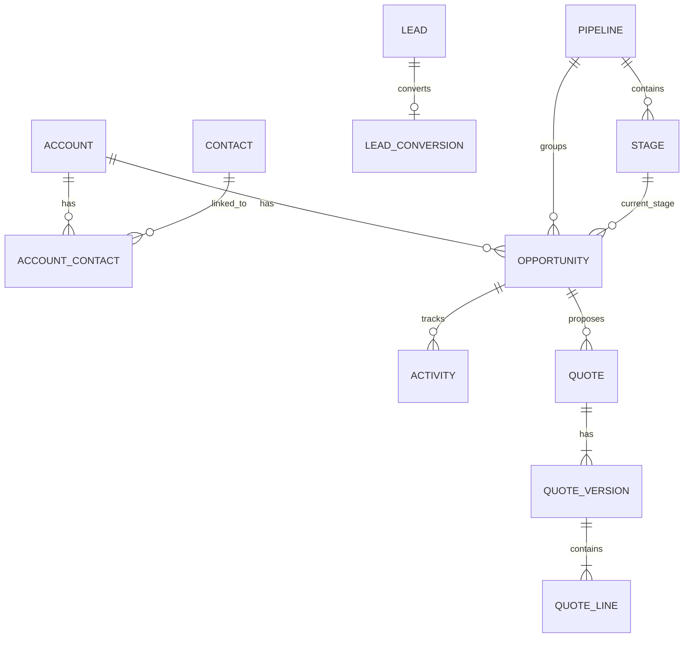
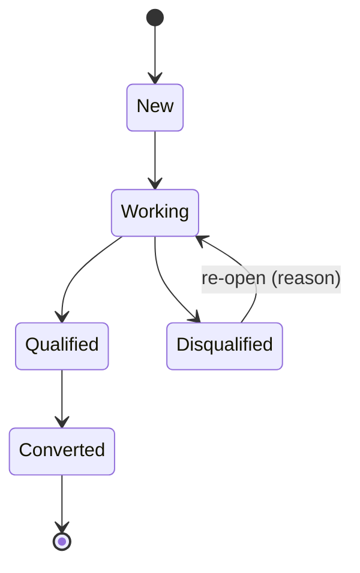

# CRM — Implementation Specification (V32.5 target)

**Status:** Proposed production service behind PioOne CRM UI. The existing repository is a frontend prototype, not an operational CRM database.

## 1. Scope and modules

Customer relationship management covers: Accounts, Contacts, Leads, Sales Pipeline, Opportunities, Activities (calls/emails/meetings/tasks), Quotations, Customer Service, Partners, Marketing, Forecasting and Commissions. CRM is the source of truth for sales relationships, opportunity progression and quotations. It does **not** own invoices, ledger, bank payments, original file binaries or signed contracts.

Key interfaces: canonical Party identity, DMS attachments, ERP order creation, PioPakt contracts, communications integrations, DCOS follow-ups and PioBrain knowledge. Responsive mobile/desktop UI and complete English/German localization are required.

## 2. Domain relationships



Company/contact identity may be shared with ERP via Party service, while sales-specific fields remain in CRM. Business documents are linked by DMS `business_links`.

## 3. Proposed data structures

Every table: `id UUID` unless junction PK composite; `tenant_id NOT NULL`, actor and timestamp audit, composite same-tenant foreign keys. Company ownership and region access enforced server-side.

| Table | Essential columns and invariants |
|---|---|
| `crm.accounts` | id, tenant_id, party_organization_id, account_number, owner_id, name, parent_account_id, industry, status, rating, billing_contact_id |
| `crm.contacts` | id, tenant_id, party_person_id, email_normalized, preferred_channel, contact_consent, status |
| `crm.account_contacts` | tenant_id, account_id, contact_id, role `decision_maker|buyer|billing|support|partner`, valid_from/to, primary_flag |
| `crm.leads` | id, tenant_id, source, name, organization_hint, email, phone, owner_id, qualification_score, status `new|working|qualified|disqualified|converted`, reason |
| `crm.lead_conversions` | tenant_id, lead_id UNIQUE, account_id, contact_id, opportunity_id nullable, converted_by, converted_at, idempotency_key |
| `crm.pipelines` | id, tenant_id, name, team_id, active, default_flag |
| `crm.stages` | id, tenant_id, pipeline_id, name, ordinal, default_probability, outcome `none|won|lost`, required_fields_json |
| `crm.opportunities` | id, tenant_id, account_id, owner_id, pipeline_id, stage_id, title, currency, amount_minor, probability, expected_close_date, status `open|won|lost`, revision |
| `crm.opportunity_contacts` | tenant_id, opportunity_id, contact_id, role |
| `crm.activities` | id, tenant_id, kind `call|email|meeting|task|note`, account_id, opportunity_id nullable, contact_id nullable, assigned_to, due_at, completed_at, status, summary, external_ref |
| `crm.quotes` | id, tenant_id, opportunity_id, customer_account_id, quote_number, status, current_version_id, accepted_version_id |
| `crm.quote_versions` | id, tenant_id, quote_id, version_number, currency, valid_until, subtotal_minor, discount_minor, tax_minor, total_minor, checksum, approval_state, sent_at |
| `crm.quote_lines` | id, tenant_id, quote_version_id, position, product_catalog_ref, quantity_decimal, unit_price_minor, tax_code, discount_minor, line_total_minor |
| `crm.campaigns` | id, tenant_id, name, channel, consent_policy, start/end, status |
| `crm.service_cases` | id, tenant_id, account_id, contact_id nullable, owner_id, queue, priority, SLA_policy, status, outcome |
| `crm.forecast_snapshots` | id, tenant_id, period, scenario, owner_id, currency, created_at, frozen_at |
| `crm.partner_assignments` | id, tenant_id, partner_party_id, account_id, opportunity_id, commission_plan_ref |
| `crm.external_refs` | tenant_id, provider, remote_id, entity_type/id, UNIQUE(tenant_id,provider,remote_id) |
| `crm.status_history` | id, tenant_id, entity_type/id, old_status, new_status, reason, actor_id, changed_at |

**Critical integrity**: enforce stage belongs to opportunity pipeline using `UNIQUE(tenant_id,pipeline_id,id)` on stages and FK `(tenant_id,pipeline_id,stage_id)` in opportunity. Enforce `quotes.accepted_version_id` and `current_version_id` belong to that quote with composite FKs involving `tenant_id,quote_id,version_id`. Approved/sent quote content immutable; reprice as new version. Money uses integer minor units with currency, explicit rounding/tax snapshot, no floating point.

## 4. Workflow state machines



**Opportunity:** `open → won|lost`; stage transitions validated against pipeline stage rules, required fields, approvals and owner permissions; reopening exceptional and audited.

**Quotation:** `draft → pending_approval → approved → sent → accepted|declined|expired|superseded`. A revision creates an immutable quote version and repeats approval according to discount/value thresholds.

## 5. End-to-end business workflows

### Lead intake and conversion

1. Collect form, campaign, email or authorized manual/worker lead; normalize contact data and consent.
2. Search same-tenant duplicate organizations/contacts; show match candidates rather than auto-merging indiscriminately.
3. Assign lead by owner/team/territory rules; create tasks and record source/consent.
4. Qualify against requirements with scored fields and captured notes.
5. Conversion transaction creates or links Party/CRM account/contact and optionally opportunity. Persist unique `lead_id` conversion and idempotency key; outbox event after commit.
6. DCOS may propose follow-up; human can accept and authorized CRM API creates activity.

### Opportunity to order (Lead-to-Cash)

1. Select account and pipeline; move through valid stages, stakeholder roles and probability/forecast.
2. Assemble quote draft from authoritative product catalog references and captured price/tax snapshots.
3. Validate all totals server-side and enforce approval matrix for exceptional discount/amount.
4. Publish/send approved immutable version using audited communications API; record delivery.
5. Capture acceptance with source evidence; link signed contract under PioPakt when needed.
6. Emit `crm.quote.accepted.v1`; ERP consumes once to create a **draft** sales order, validates legal entity/currency/tax and reports result; CRM cannot silently assume order completion.
7. Subsequent invoices/payments remain in ERP. DCOS briefing reads CRM pipeline and ERP financial status via respective APIs.

### Customer service

Support case → classification → assignment/priority/SLA → investigation → escalation/human approval → resolution → closure. Where ITSM is authoritative, CRM holds external case reference instead of duplicating case state.

## 6. Proposed API contracts

```http
GET/POST  /api/v1/crm/accounts
GET/PATCH /api/v1/crm/accounts/{id}
GET/POST  /api/v1/crm/contacts
POST      /api/v1/crm/accounts/{id}/contacts
GET/POST  /api/v1/crm/leads
POST      /api/v1/crm/leads/{id}:qualify
POST      /api/v1/crm/leads/{id}:convert
GET/POST  /api/v1/crm/pipelines
GET/POST  /api/v1/crm/pipelines/{id}/stages
GET/POST  /api/v1/crm/opportunities
PATCH     /api/v1/crm/opportunities/{id}
POST      /api/v1/crm/opportunities/{id}:advance
POST      /api/v1/crm/opportunities/{id}:close
GET/POST  /api/v1/crm/activities
GET/POST  /api/v1/crm/quotes
POST      /api/v1/crm/quotes/{id}/versions
POST      /api/v1/crm/quote-versions/{id}:submit
POST      /api/v1/crm/quote-versions/{id}:approve
POST      /api/v1/crm/quote-versions/{id}:send
POST      /api/v1/crm/quote-versions/{id}:accept
GET       /api/v1/crm/dashboard?period=...
```

Idempotency for conversion, sending and acceptance; ETag/If-Match on updates; cursor pagination; authenticated tenant/org/role filtering; structured errors. Example opportunity:
```json
{"account_id":"uuid","pipeline_id":"uuid","stage_id":"uuid","title":"Municipal digitization","amount_minor":15000000,"currency":"EUR","expected_close_date":"2027-02-01"}
```

## 7. Events, permissions and documents

Events: `crm.lead.created.v1`, `crm.lead.converted.v1`, `crm.opportunity.stage_changed.v1`, `crm.opportunity.won.v1`, `crm.quote.version_approved.v1`, `crm.quote.accepted.v1`.

Cross-domain handoffs via transactional outbox/inbox deduplication. Attachments via DMS file/version IDs, ACL-checked before visibility. Worker reads limited to delegated customer/opportunity/activities scopes; sensitive exports logged. Forecast reports must not sum mixed currencies without defined FX conversions. Marketing consent tracked and revocable; retention/legal basis reviewed per jurisdiction.

## 8. Implementation stages and tests

**Phase 1:** Accounts/Contacts/Leads/Conversion, Pipelines/Stages/Opportunities, Activities and DMS links.  
**Phase 2:** Quotes, versioning, approval and ERP/PioPakt integration.  
**Phase 3:** Service cases, forecasting, marketing, partner/commission features, analytics.

Acceptance tests: lead conversion is idempotent; cross-pipeline stage rejected; accepted version belongs to correct quote; quote approved content cannot mutate; unauthorized worker denied; duplicate accepted quote never creates duplicate ERP order; source-linked CRM tasks appear correctly in DCOS briefing; all paths tenant isolated; responsive DE/EN forms/tables pass real integration tests.
