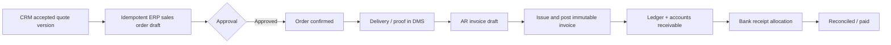
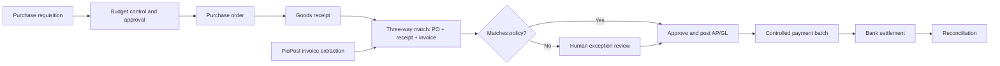

# ERP — Implementation Specification (V32.5 target)

**Status:** Proposed production implementation. V32.5 in this repository is a React frontend prototype, not an operational finance system.

## 1. Purpose and functional scope

ERP owns financial and operational records, not DCOS. Modules include General Ledger, Chart of Accounts, Fiscal Periods, Sales Orders, Invoicing/Accounts Receivable, Suppliers, Procurement, Accounts Payable, Payments, Banking/Reconciliation, Inventory, Warehouses, Budgets/Controlling, Fixed Assets, Subscriptions and Reporting.

**System boundaries:** CRM owns accepted quotation versions and customer pipeline, ERP owns orders and posted invoices/GL; PioPakt owns contractual workflows; DMS owns invoice originals and attachments; PioPost proposes OCR-extracted input; My Assistant/PioWorker initiates authorized actions but cannot bypass policy or write ERP base tables directly.

## 2. Data structure (PostgreSQL `erp` schema)

Every tenant-scoped table includes `id UUID`, `tenant_id UUID NOT NULL`, creation/update metadata, actor and composite tenant-safe foreign keys. Financial values use exact `NUMERIC` or integer minor units with currency and rounding policy, never floating-point.

| Table | Key fields and constraints |
|---|---|
| `erp.books` | tenant_id, id, legal_entity_id, base_currency, accounting_standard, status |
| `erp.fiscal_periods` | tenant_id, id, book_id, year, period, start/end, state `open|closing|closed` |
| `erp.gl_accounts` | tenant_id, id, book_id, account_code, name, class, active; UNIQUE(tenant_id,book_id,account_code) |
| `erp.journal_entries` | tenant_id, id, book_id, period_id, source_type/id, posting_date, state `draft|posted|reversed`, posted_at, reversal_id, idempotency_key |
| `erp.journal_lines` | tenant_id, id, entry_id, line_no, account_id, debit_minor, credit_minor, base_amount_minor, currency, fx_rate_snapshot; signed posting amounts must balance per entry |
| `erp.customers` | tenant_id, id, party_organization_id, legal_entity_id, terms, credit_limit |
| `erp.sales_orders` | tenant_id, id, legal_entity_id, customer_id, crm_quote_version_ref, contract_ref, currency, state, revision |
| `erp.sales_order_lines` | tenant_id, id, order_id, product_ref, qty_decimal, unit_price_minor, tax_code, discount_minor, total_minor |
| `erp.deliveries` | tenant_id, id, order_id, delivered_at, proof_dms_version_id, state |
| `erp.ar_invoices` | tenant_id, id, customer_id, legal_entity_id, order_id, invoice_number, issue/due dates, currency, gross_minor, tax_minor, state, journal_entry_id |
| `erp.ar_invoice_lines` | tenant_id, id, invoice_id, order_line_id, qty, price, tax_code, line_total |
| `erp.ar_receipts` | tenant_id, id, customer_id, bank_transaction_id, currency, amount_minor, received_at |
| `erp.ar_allocations` | tenant_id, id, receipt_id, invoice_id, amount_minor |
| `erp.credit_notes` | tenant_id, id, invoice_id, reason, amount_minor, posted_journal_id |
| `erp.suppliers` | tenant_id, id, party_organization_id, legal_entity_id, payment_terms, verified_bank_ref |
| `erp.purchase_requests` | tenant_id, id, requester_id, cost_center_id, purpose, amount_minor, state |
| `erp.purchase_orders` | tenant_id, id, legal_entity_id, supplier_id, request_id, currency, state, approved_by |
| `erp.purchase_order_lines` | tenant_id, id, po_id, item_ref, qty, unit_price, tax_code |
| `erp.goods_receipts` | tenant_id, id, po_id, received_by, received_at, state |
| `erp.goods_receipt_lines` | tenant_id, id, goods_receipt_id, po_line_id, accepted_qty, rejected_qty |
| `erp.ap_invoices` | tenant_id, id, legal_entity_id, supplier_id, external_invoice_number, invoice_date, due_date, dms_file_version_id, amount_minor, currency, state, journal_id |
| `erp.ap_invoice_lines` | tenant_id, id, invoice_id, po_line_id, receipt_line_id, qty, price, tax |
| `erp.match_results` | tenant_id, id, invoice_id, po_id, receipt_id, tolerance_policy, discrepancy_json, outcome |
| `erp.payment_batches` | tenant_id, id, legal_entity_id, bank_account_id, amount_minor, currency, prepared_by, approved_by, state |
| `erp.payment_items` | tenant_id, id, batch_id, ap_invoice_id, beneficiary_account_ref, amount_minor, bank_external_ref, state |
| `erp.bank_accounts` | tenant_id, id, legal_entity_id, masked_iban, secure_iban_ref, gl_account_id, currency |
| `erp.bank_transactions` | tenant_id, id, bank_account_id, external_transaction_id, booking_date, signed_amount_minor, currency, reconciliation_state |
| `erp.bank_reconciliations` | tenant_id, id, transaction_id, source_type/id, amount_minor, reconciled_by |
| `erp.items` | tenant_id, id, SKU, name, uom, valuation_method, stock_controlled |
| `erp.warehouses` | tenant_id, id, legal_entity_id, location, status |
| `erp.stock_movements` | tenant_id, id, warehouse_id, item_id, qty_signed, valuation_amount, source_ref, posted_at; append-only |
| `erp.stock_reservations` | tenant_id, id, item_id, warehouse_id, order_line_id, quantity, expires_at |
| `erp.budgets` | tenant_id, id, legal_entity_id, cost_center_id, fiscal_period_id, revision, approved_by, state |
| `erp.budget_lines` | tenant_id, id, budget_id, gl_account_id, planned_amount_minor, committed_amount_minor |
| `erp.fixed_assets` | tenant_id, id, legal_entity_id, acquisition_cost_minor, depreciation_method, start_date, source_invoice_ref |
| `erp.depreciation_entries` | tenant_id, id, asset_id, period_id, amount_minor, journal_id |

**Financial invariants:** Entries post atomically only when debit = credit in the base currency; no posting in closed fiscal periods; posted journals cannot be edited/deleted, only reversed. Duplicate external requests and events must never create duplicate posted finance or bank transfers. AR allocation cannot exceed available receipt or outstanding invoice except via explicit overpayment flow. Tax/invoice legal rules depend on jurisdiction and require finance/legal review (e.g. HGB/GoBD/VAT/e-invoicing for German entities).

## 3. Canonical workflows

### Lead-to-Cash (CRM → ERP)



1. Validate customer/legal entity, accepted quote version, currency, line items and source event ID.
2. Create sales order draft exactly once; get pricing/tax snapshots and attach contract reference.
3. Run approval policy; reserve inventory/plan service delivery; record fulfillment.
4. Create invoice draft from allowed fulfilled lines, validate tax and invoice number, issue and post AR/GL atomically.
5. Reconcile imported bank receipts and publish payment status. CRM reads status; it does not change ERP postings.

### Procure-to-Pay (PioPost/DMS → ERP)



1. Capture request, supplier, amount and cost center; check approved budget and authority.
2. Approve/create PO; receive goods/services and evidence.
3. Extract invoice via PioPost, store original DMS version, detect duplicates, validate supplier and tax.
4. Match invoice to PO and receipt within controlled tolerances; send variances to human review.
5. Approve AP and balanced GL posting; create payment proposal, enforce segregation of duties (maker/checker).
6. Submit payment through bank provider only after authorized approval; reconcile bank transaction, audit and emit status.

### Accounting period close

Reconcile subledgers, bank statements, inventory valuation, accruals; produce trial balance; approve close; lock fiscal period; require explicitly audited exception to reopen. Restore must preserve posted ledger/reconciliation consistency and prevent replayed payment sends.

## 4. State transitions

- Invoice: `draft → approved → issued → posted → partially_paid → paid`; corrections via `credit_note`, not editing posted records.
- Purchase order: `draft → pending_approval → approved → sent → partially_received → received → closed`.
- AP invoice: `captured → validated → matched → approved → posted → partially_paid → paid`; disputed branch on mismatch.
- Payment: `prepared → pending_approval → approved → submitted → settled|failed`; bank response is authoritative.
- Journal: `draft → posted`; reversal creates separate balanced entry with original reference.
- Inventory movement: draft reservation; committed movement append-only, with reverse/adjustment movement as correction.

## 5. API contracts (gateway proposals)

```http
GET/POST /api/v1/erp/books
GET/POST /api/v1/erp/gl/accounts
GET/POST /api/v1/erp/journal-entries
POST /api/v1/erp/journal-entries/{id}:post
POST /api/v1/erp/journal-entries/{id}:reverse
GET/POST /api/v1/erp/sales-orders
POST /api/v1/erp/sales-orders:from-quote
POST /api/v1/erp/sales-orders/{id}:approve
GET/POST /api/v1/erp/ar-invoices
POST /api/v1/erp/ar-invoices/{id}:issue
POST /api/v1/erp/ar-invoices/{id}:post
GET/POST /api/v1/erp/purchase-requests
GET/POST /api/v1/erp/purchase-orders
GET/POST /api/v1/erp/goods-receipts
GET/POST /api/v1/erp/ap-invoices
POST /api/v1/erp/ap-invoices/{id}:match
POST /api/v1/erp/ap-invoices/{id}:post
GET/POST /api/v1/erp/payment-batches
POST /api/v1/erp/payment-batches/{id}:approve
POST /api/v1/erp/payment-batches/{id}:submit
GET/POST /api/v1/erp/bank-transactions
POST /api/v1/erp/bank-transactions/{id}:reconcile
GET/POST /api/v1/erp/stock-movements
GET /api/v1/erp/reports/trial-balance
GET /api/v1/erp/reports/ar-aging
GET /api/v1/erp/reports/ap-aging
```

Use authenticated tenant/legal entity context, strict roles, idempotency keys for posting/payment, ETag revision for drafts, structured errors, cursor pagination and event correlation. All state transitions occur on server.

## 6. Events and integrations

Emit `erp.sales_order.created.v1`, `erp.sales_order.confirmed.v1`, `erp.ar_invoice.posted.v1`, `erp.ar_invoice.paid.v1`, `erp.ap_invoice.posted.v1`, `erp.payment.settled.v1`, `erp.stock.changed.v1`, `erp.period.closed.v1`. Consume `crm.quote.accepted.v1`, PioPakt contract links, DMS document version events, PioPost capture proposals and bank acknowledgements. Transactional outbox + inbox dedup; no full financial PII in emitted payload.

PioBrain may retrieve authorized source documents and policy manuals, but not compute authoritative ledger balances from embeddings. DCOS morning briefing reads server-validated AR/AP aging, payment approvals, budgets and exceptions with source record IDs/revisions.

## 7. Security, recovery and release acceptance

Roles and separation of duties for read/draft/approve/post/bank-submit/close. Bank account changes require verification and immutable audit. Data retention and tax rules configured by legal entity/jurisdiction. Postgres PITR and DMS object version manifests must restore consistent invoice/document evidence. Test restore without duplicate payments.

**Engineering phases:** (1) GL/periods/tax/legal entities; (2) sales orders/AR; (3) procurement/AP and PioPost intake; (4) banking; (5) inventory/assets/controlling; (6) advanced analytics/subscriptions.

**Acceptance tests:** balanced journals enforced; cross-tenant and cross-company posting denied; posted invoice immutable; duplicate accepted quote maps to one sales order; duplicate supplier bill flagged; three-way mismatch requires review; unapproved bank payment cannot submit; invoice document links resolve exact versions; partial restore/replay cannot double-post or double-pay; DE/EN desktop/mobile pages pass integration tests.
