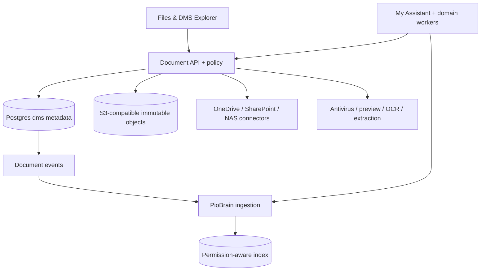
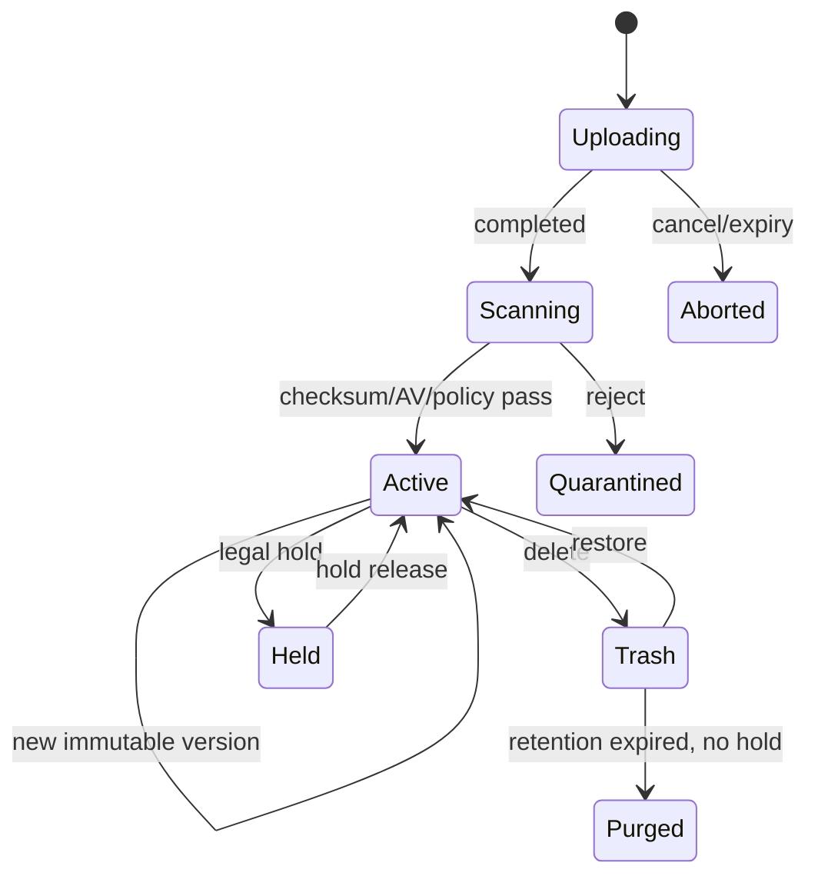

# Files & DMS — Implementation Specification (V32.5 target)

**Status:** Proposed production backend for the PioOne Files & DMS UI. **Datei & DMS** is the existing German workspace name; engineering documentation is in English.

## 1. Product goals

**One Explorer for all daily files:** a native file manager similar to OneDrive combined with enterprise document records and integrated external providers. Personal files can be unrelated to business applications.

Four explicit storage spaces:
1. **My Drive** — personal/private storage, user quota, folders, photos, PDFs, arbitrary permitted file formats.
2. **Team Drives** — shared team/department/project folders with inherited/explicit permissions.
3. **Enterprise Documents** — governed records linked to CRM, ERP, HR, Projects, Travel, KiDiS and PioPakt, with retention/audit.
4. **Connected Drives** — provider-aware views over OneDrive, SharePoint, NAS/SMB and S3; external ACL and sync semantics honored.

Features: hierarchical folders, breadcrumbs, drag-and-drop, preview, upload/download, create/move/rename/copy, search, tags, favorites, shares, versions, trash/restore, quota, activity/history, external sync status, PioBrain indexing and DCOS folder grants. Desktop/tablet/mobile and DE/EN.

## 2. Data/storage architecture



**Authoritative storage:** DMS owns native file metadata and current versions. Original bytes are encrypted S3-compatible objects. Connected-provider authority must be declared: mirrored, cached or live reference. Business apps link to file IDs, not copy the bytes. PioBrain stores only derived indexes/chunks with source revision and ACL provenance; worker memory is never a file store.

### Residency and processing policy

Live PostgreSQL is installed on supported database storage, **not OneDrive**. OneDrive may serve as an external file connector or suitable encrypted backup export. Hybrid runs approved customer storage/services through an outbound secure data gateway, not raw browser access. Local file residency alone does not imply local AI inference; privacy policy must govern processing location.

## 3. Proposed PostgreSQL schema

All data tenant-scoped; include `id UUID`, `tenant_id UUID NOT NULL`, creator, timestamps and audit. Add `UNIQUE(tenant_id,id)` on cross-referenced tables for composite foreign keys.

| Table | Fields / constraints |
|---|---|
| `dms.drives` | tenant_id, id, type `personal|team|enterprise|external`, owner_principal_id, org_unit_id, display_name, storage_provider_id, root_folder_id, quota_bytes, used_bytes, status; personal drive UNIQUE(tenant_id,owner_principal_id) where type='personal' |
| `dms.folders` | id, tenant_id, drive_id, parent_folder_id nullable, name, normalized_name, inheritance_enabled, deleted_at, revision; same-drive parent FK; unique live sibling name; prevent cycles |
| `dms.files` | id, tenant_id, drive_id, folder_id, name, mime_type, current_version_id, state `active|quarantined|trash|held`, owner_id, classification, bytes, revision |
| `dms.file_versions` | id, tenant_id, file_id, version_number, storage_object_id, sha256, bytes, mime_type, scan_state, created_by, created_at, source_version_id, UNIQUE(tenant_id,file_id,version_number) |
| `dms.storage_objects` | id, tenant_id, provider_id, bucket, object_key, provider_version_id, bytes, sha256, encryption_key_ref, storage_class, immutable_until, lifecycle_state |
| `dms.providers` | id, tenant_id, kind `s3|onedrive|sharepoint|nas`, credentials_secret_ref, capability_flags, root_ref, state, residency, sync_cursor |
| `dms.upload_sessions` | id, tenant_id, drive_id, folder_id, reserved_bytes, transferred_bytes, expected_sha256, expires_at, state, idempotency_key |
| `dms.acl_grants` | id, tenant_id, resource_type, resource_id, subject_type, subject_id, rights, purpose, inheritance_source, expires_at, revoked_at |
| `dms.share_links` | id, tenant_id, file_or_folder_ref, secret_hash, target_id nullable, rights, expires_at, max_uses, revoked_at |
| `dms.business_links` | id, tenant_id, file_id, domain `crm|erp|hr|projects|travel|kidis|contracts`, entity_type, entity_id, link_role; unique per domain/entity/role |
| `dms.favorites` | tenant_id, principal_id, item_type, item_id, created_at |
| `dms.tags` / `dms.file_tags` | tenant-scoped tags and associations |
| `dms.trash_entries` | id, tenant_id, resource_ref, previous_parent_id, deleted_at, purge_after, actor_id |
| `dms.retention_policies` | id, tenant_id, class, minimum_retention, disposal_rule, jurisdiction |
| `dms.legal_holds` | id, tenant_id, resource_ref, matter_id, set_by, active_since, released_at |
| `dms.index_jobs` | id, tenant_id, file_version_id, grant_id, parser_version, state, indexed_at, error_code |
| `dms.external_refs` | id, tenant_id, provider_id, local_file_id, remote_item_id, remote_etag, sync_state, conflict_state |
| `dms.access_audit` | id, tenant_id, actor_id, delegated_worker_id, file_id, version_id, action, allowed, timestamp |

**Integrity rules:** `files.current_version_id` must belong to the same `file_id` and tenant; composite FK on `(tenant_id,file_id,current_version_id)` to file_versions corresponding composite unique key. Folder parent must belong to same drive and tenant. Deleting nonempty folder uses explicit recursive policy; avoid cross-drive cycles. Quota reservation must be atomic and race safe; `used_bytes + reserved_bytes <= quota_bytes`. Deduplication must not reveal cross-tenant existence.

## 4. Upload and file lifecycle



**Upload workflow:** validate token/ACL, folder/name/quota; reserve quota in one DB transaction; create multipart upload using scoped presigned URL; receive file, validate size/hash/antivirus and encryption; create storage object and immutable version; point current version to new version; finalize quota; commit outbox event; asynchronous OCR/preview/index. Failed/abandoned sessions release reservation and schedule object cleanup.

**Version workflow:** every content edit creates a new version. Restoring old v2 while latest v5 exists **creates v6** referencing original content; it does not delete or mutate v5. Metadata changes use revisions/audit and don't necessarily create content versions.

**Share workflow:** explicit recipient/right/scope/expiry, no publicly discoverable token; permissions checked on list/search/download and again at presigned URL issuance. A generated share link can never exceed original user/module permission.

**Delete workflow:** soft-delete/trash; revoke access and index visibility immediately; legal hold and retention block permanent purge. Worker requests deletion only through authorized API + human gate where necessary.

## 5. RAG/worker permission policy

- **Private My Drive:** default personal content is not indexed for DCOS/PioBrain until user grants folder/file scope and purpose. Admin quota permission does not imply content access.
- **Enterprise:** domain ACL + DMS ACL + classification + retention all apply; legal records restricted as necessary.
- **Knowledge index:** `tenant_id`, `source_file_id`, `file_version_id`, `chunk_hash`, `page_anchor`, `acl_revision`, `embedding_model_version`; re-check source ACL at retrieval; deletions/revocations block instantly and trigger index removal.
- Connector source data must not be silently copied/embedded outside permitted processing geography.

## 6. REST contracts (proposed gateway)

```http
GET    /api/v1/drives
POST   /api/v1/drives
GET    /api/v1/folders?drive_id=...&parent_id=...&cursor=...
POST   /api/v1/folders
PATCH  /api/v1/folders/{id}                 (If-Match)
GET    /api/v1/files?drive_id=...&folder_id=...
POST   /api/v1/files/uploads
POST   /api/v1/files/uploads/{id}:complete
POST   /api/v1/files/uploads/{id}:abort
GET    /api/v1/files/{id}/versions
POST   /api/v1/files/{id}/versions/{version}:restore
GET    /api/v1/files/{id}/download
PATCH  /api/v1/files/{id}
POST   /api/v1/files/{id}:trash
POST   /api/v1/files/{id}:restore
POST   /api/v1/files/{id}:share
DELETE /api/v1/shares/{id}
POST   /api/v1/files/{id}/business-links
GET    /api/v1/files:search?q=...&scope=...
GET    /api/v1/storage/quotas
GET    /api/v1/storage/connectors
POST   /api/v1/storage/connectors:validate
POST   /api/v1/knowledge-grants
DELETE /api/v1/knowledge-grants/{id}
```

Every operation produces an audit/correlation ID, verifies tenant and effective policy and reports connector capability/unavailability accurately. Pagination and search must filter authorization **before** returning results/counts.

## 7. External connectors

OneDrive/SharePoint: OAuth scoped credentials in vault, delta query/webhooks with stateful sync cursor, throttling/backoff, remote ETags and conflict resolution; choose remote ACL or mirrored ACL authority explicitly. NAS: customer-side agent via encrypted outbound gateway; SMB credentials never exposed in browser; provider-specific file semantics. S3: scoped IAM/prefix, server-side encryption, object version IDs and retention settings.

## 8. Backup and disaster recovery

Consistent recovery manifest correlates database snapshot/WAL position with exact binary object versions and key references. Test isolated restores; reconcile file metadata/object references, shares, business links and index rebuilds. Restoring content must not recreate revoked access grants or send workflow actions.

## 9. Delivery phases and acceptance

Phase 1: native drives, folder metadata/tree, upload/download, quota/permissions. Phase 2: immutable versions/restore, shares, tags, search, trash, retention. Phase 3: PioBrain indexing and explicit worker grants. Phase 4: external connectors, migration and DR.

Acceptance: user A cannot read user B private folder or discover it through search/DCOS; arbitrary personal files work without business link; concurrent uploads cannot exceed quota; file v2 restore creates v6; wrong tenant file IDs fail; document linked to CRM and ERP references one controlled source file; deleted document cannot be returned from RAG; corrupted upload never published; connector outage is honestly displayed; backup restore preserves exact cited file versions.
