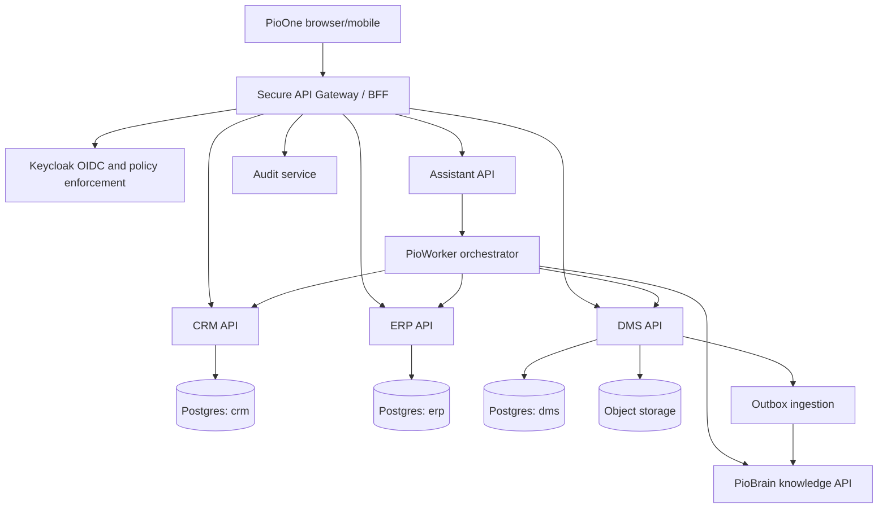

# PioOne V32.5 — Shared Platform Architecture & Data Contracts

**Status:** Proposed service design (not implemented in the V32.5 frontend).

## Deployment and ownership

PioOne is an AI-native daily workspace. React provides UI; the API gateway enforces Keycloak/OIDC authentication and exposes resource-oriented endpoints. Internal Go services may use gRPC and message/event envelopes. PioWorker runs assistants/workflows; PioBrain provides permission-aware search/retrieval.



**Record ownership**: Core identity/organization owns tenants and memberships; Party owns canonical person/organization identifiers; CRM owns leads/accounts/opportunities/quote versions; ERP owns financial and stock transactions; DMS owns files and metadata; Assistant/PioWorker owns run state, tool calls, approvals; PioBrain owns derived indexes. Never create an alternate financial or document system of record inside worker memory.

## Platform relational entities

All tenant-bound rows use UUID primary IDs, `tenant_id NOT NULL`, `created_at`, `updated_at`, revision, actor and composite tenant-safe FKs. Enforce foreign keys across the same tenant and restrict cross-tenant queries by server authorization plus PostgreSQL RLS.

| Table | Important columns |
|---|---|
| `core.tenants` | id, slug, status, residency_policy_id |
| `core.legal_entities` | id, tenant_id, name, jurisdiction, base_currency |
| `core.org_units` | id, tenant_id, parent_id, name, kind |
| `core.principals` | id, tenant_id, idp_subject, kind(user/service/worker), status |
| `core.memberships` | tenant_id, principal_id, org_unit_id, role_id, valid_from/to |
| `core.grants` | tenant_id, subject_id, resource_type/id, action, effect, conditions, expires_at |
| `party.organizations` | id, tenant_id, legal_name, registration_id, status |
| `party.people` | id, tenant_id, identity/contact fields, data_classification |
| `party.relationships` | tenant_id, organization_id, person_id, role, valid_from/to |
| `integration.outbox_events` | id, tenant_id, aggregate, event_type, schema_version, payload, published_at |
| `integration.inbox_dedup` | consumer, event_id, processed_at, UNIQUE(consumer,event_id) |
| `audit.events` | id, tenant_id, actor_id, delegated_user_id, resource, action, outcome, correlation_id, timestamp |

## API conventions

Browser → BFF via authenticated HTTPS. Internal service communication should be versioned (gRPC suitable for existing Go/PioWorker stack). Identity context derived from verified OIDC token, not a browser-controlled tenant header. Required request metadata: request/correlation IDs, delegated principal (if worker), purpose, idempotency key for mutations and ETag for updates.

Errors use stable `code`, human-readable `message`, `field_errors`, `retryable`, `correlation_id`. List endpoints use cursor pagination, policy-filtered results and explicit sorting.

Outbox event envelope:
```json
{"event_id":"uuid","event_type":"crm.opportunity.won.v1","schema_version":1,
 "tenant_id":"uuid","aggregate_type":"opportunity","aggregate_id":"uuid",
 "revision":12,"actor_id":"uuid","correlation_id":"uuid",
 "occurred_at":"RFC3339","payload":{"account_id":"uuid"}}
```
Events are delivered at least once. Consumers deduplicate before business side effects. No object bytes, credentials or full confidential documents in events.

## Data storage and data sovereignty

- **PostgreSQL**: transactions, metadata, permissions, audit references and durable run checkpoints.
- **S3-compatible objects**: files and immutable versions; encrypted keys/objects, checksums and optional legal holds.
- **PioBrain**: OCR/chunks/full-text/vector indexes derived from authorized DMS versions. Revocation must immediately deny retrieval and schedule index cleanup.
- **OneDrive/SharePoint/NAS**: connected file repositories via scoped connector and server-side credentials, not interchangeable with PostgreSQL live storage.
- **Worker state**: run/version/checkpoint and limited consent-controlled memory, not originals.
- **Cloud/hybrid/on-prem**: separate configuration for live DB, file data, index data, inference processing and runtime. Hybrid requires secure outbound gateway; do not claim full privacy merely because files are on customer storage when cloud AI processes content.

## Security and governance

Tenant isolation, role/attribute/purpose-based policy, privacy classification, explicit worker delegation and per-tool scopes. My Drive private by default; administrators can manage quotas but should not automatically receive content access. Human approval for binding communications/contract, finance postings, bank releases and regulated decisions per policy. Append-only action/approval audit; consent and retention policies; encryption and secrets management.

## Backup, versioning and DR

PostgreSQL backup + WAL archiving for PITR, S3 object versioning and independent encrypted immutable backups. Manifest correlates database checkpoint, file object IDs/versions, schema versions, worker definitions, encryption-key references and checksums. Restore to isolated staging first, validate metadata/object references, then controlled production cutover. File version restore is different from database PITR and application version deployment. RPO/RTO set through customer policy, not assumed.

## Acceptance

1. Guessed tenant B ID cannot access records in tenant A.
2. Worker with user delegation cannot exceed user's granted scopes.
3. Source revocation makes knowledge snippets inaccessible immediately.
4. Replayed event does not duplicate invoice/order, email send or payment.
5. Backup restore yields valid file versions and business links, including prior versions.
6. Hybrid deployment blocks disallowed cloud processing even if file storage remains local.
